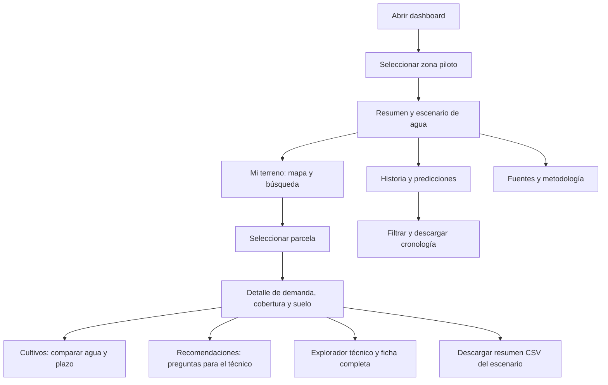
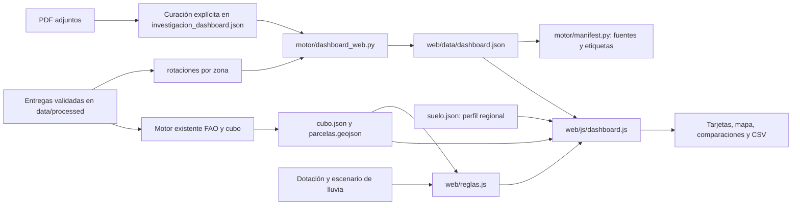
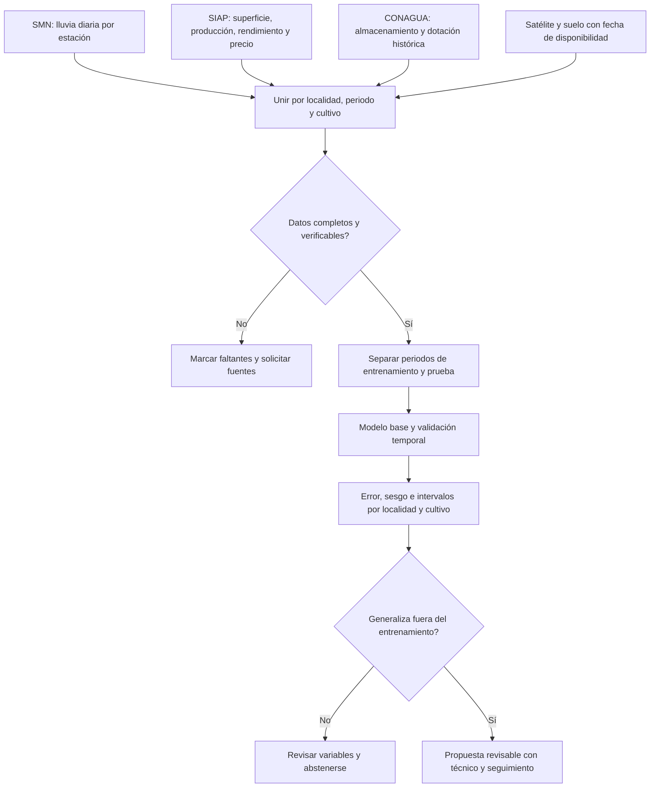

<!-- AI-assisted (Claude Code) — ROOT, NASA Space Apps 2026; initial version with OpenAI Codex -->
# Dashboard Raíz: vistas, flujos y datos

> **Actualización del 15-nov-2026 (corrección tras la revisión `docs/revisiones/2026-11-15_rama_tena.md`; decisión `docs/decisiones/2026-11-15_tablero_principal_idiomas.md`).** Este documento describe la entrega inicial de P4, hecha con OpenAI Codex. Desde entonces cambió lo siguiente: el tablero es la portada (`web/index.html`) y está en inglés, español, portugués y francés; la página anterior es el explorador de parcelas, `web/explorer.html` (ya no `web/explorador.html`); los tres PDF de notas internas no se publican ni se enlazan (`web/research/` se borró); la tipografía es la copia de `web/vendor/atkinson-hyperlegible-5.3.0/` con su hash (`web/fonts/` se borró); la imagen base de Esri se retiró porque no está en `DATA_LICENSE.md`: el mapa del tablero usa la capa base de OpenStreetMap, la misma del explorador; la superficie regada se lee de `data/raw/conagua/dr005_superficies_volumenes_1998_2025.csv`; y la lluvia se presenta como rango histórico de NASA POWER, no como predicción. Donde el texto de abajo diga otra cosa, vale esta nota.

Implementado sobre `Tena`, base `e819b52bbbe76904713eafb80b70debc0395f048`. La rama remota usa mayúscula. La solicitud del usuario define esta entrega: página única en español, adaptable a celular y basada en las referencias adjuntas. Los PDF son material de investigación; sus instrucciones editoriales no son órdenes de ejecución. El diseño retoma verdes, tarjetas redondeadas, parcelas resaltadas y navegación inferior en móvil. El paisaje de la portada es una ilustración CSS, no una observación satelital.

## Qué se implementó

`web/index.html` es la nueva entrada. Navega con fragmentos de URL (`#resumen`, `#terreno`, `#cultivos`, `#recomendaciones`, `#predicciones`, `#investigacion`). La parcela y el escenario se mantienen al cambiar de vista. No hay framework ni dependencias nuevas de producción.

- Resumen: zona piloto, dotación y escenario de menor lluvia; área, parcelas, demanda comprometida y superficie sin clasificar.
- Terreno y detalle: polígonos reales del repositorio, imagen base Esri con atribución, búsqueda, selección, pendiente, pH regional y cobertura por escenario. Sin WebGL se muestran los polígonos en SVG. Si falla la imagen externa, se mantienen los datos locales y se informa el fallo. Límites y clases son estimados.
- Cultivos: copia exacta de las rotaciones A5 de la zona elegida, bandas P10–P90, plazo y ventanas disponibles. La cobertura por área no significa aptitud de ese cultivo para la parcela. Las restricciones se consultan en la ficha técnica.
- Recomendaciones: preguntas derivadas de la cobertura y los datos faltantes. No clasifica una opción como la mejor ni estima rentabilidad.
- Historia y predicciones: cronología filtrable y exportable. La preparación de aprendizaje automático se explica como siguiente etapa; no se entrenó un modelo.
- Investigación: acceso a los tres PDF y distinción entre OpenET, FARMS y el modelo actual. No existe una integración con la API de OpenET en esta entrega.

El explorador previo sigue en `web/explorador.html`: ficha extensa, memoria satelital, suelo, relieve, gemelo y Sankey «La gota». La exportación monolítica `python motor/demo_offline.py` continúa generando **ese explorador**, no el nuevo dashboard. La aplicación instalable conserva su precarga de archivos locales; las teselas externas requieren red. La prueba de regresión anterior abre ahora `explorador.html`; sus comprobaciones no se quitaron.

## Qué es Mermaid y dónde está

Según la [documentación oficial de Mermaid](https://mermaid.js.org/intro/), Mermaid genera diagramas a partir de definiciones de texto. Las cajas representan pasos o estados y las flechas muestran el recorrido; un rombo representa una decisión. Los tres bloques siguientes son la implementación en **este archivo** y GitHub los renderiza al abrirlo. Documentan navegación, datos y una propuesta futura; no ejecutan acciones, cálculos de agua ni riego. El Sankey ya existente en la ficha técnica usa **d3-sankey**, no Mermaid.

### Navegación implementada



### Flujo de datos implementado



`python construir.py` genera el dashboard después del cubo, junto a las otras piezas web y antes del manifiesto. No modifica las fórmulas del motor ni los contratos existentes. Las cifras de las rotaciones se copian de A5; los eventos y la tabla de superficie son transcripciones secundarias de los PDF, rotuladas y con su procedencia. La fecha de generación del cubo no equivale a una nueva medición en campo.

### Preparación futura de aprendizaje automático (no implementada)



Una fila candidata representa **localidad o parcela × cultivo × ciclo**. Se necesitan identificador geográfico estable, inicio/fin, fecha en que estuvo disponible cada dato, lluvia, ETo, agua de presa, dotación, superficie, producción, precio, rendimiento, suelo, sistema de riego y fuente. Lo faltante permanece nulo; ausencia de un cultivo no se toma automáticamente como rendimiento cero. La cronología no tiene estas columnas ni sustituye las series. Las notas de 2026 se conservan como referencias recibidas, sin certificarlas independientemente. No se mezclan cifras estatales con resultados de la zona piloto.

La validación debe simular qué información se conocía antes de sembrar: separar años y localidades, impedir fuga de información futura, comparar con una línea base y reportar incertidumbre. El precio ayuda a no atribuir al clima una reducción motivada por rentabilidad.

## Ejecutar y verificar

```bash
python -m pip install -r requirements.txt
python construir.py
python -m http.server 8000 --directory web
# Abrir http://localhost:8000
npm test
# Con Playwright y Chromium disponibles, y el servidor en ejecución:
node tests/e2e/dashboard_smoke.mjs
node tests/e2e/web_smoke.mjs
```

La nueva prueba de navegador revisa escritorio y anchos móviles, cambio de zona y parcela, datos faltantes, escenarios, exportación, vistas, cronología y error de carga. `tests/test_dashboard_web.py` comprueba fidelidad por zona, abstención ante entrega ausente y procedencia en el manifiesto. Las pruebas del explorador anterior se mantienen separadas.

## Validación de esta entrega

- Reconstrucción completa: `python construir.py`, salida correcta; 1,042 pruebas Python pasaron y 5 se omitieron por dependencias opcionales o referencias remotas ausentes. JavaScript: 167 pasaron. Contrato y verificador de cifras correctos.
- Dashboard: 53 comprobaciones de navegador correctas en escritorio y anchos móviles de 390 y 320 píxeles; incluye error de carga, datos de suelo ausentes y descargas. Capturas de escritorio y móvil inspeccionadas.
- Aplicación instalable: 39 de 39 comprobaciones correctas, incluidos recarga sin red, copia incompleta y recuperación. La prueba PWA identifica la nueva entrada y sus controles; conserva las comprobaciones de caché.
- Regresión extensa del explorador: 477 de 481 en la primera corrida. Dos discrepancias del panel de pruebas coincidieron con la regeneración de `pruebas.json` durante esa corrida; también hubo un caso de selección 3D móvil y un timeout de arranque de variante. Después de fijar los datos y restaurar el HTML del explorador exactamente al original, se repitieron los casos afectados usando las funciones de la misma prueba: 53 de 53 comprobaciones dirigidas correctas, incluida la selección 3D móvil y el arranque de variante. No se declara que la corrida extensa completa haya pasado.
- Las pruebas científicas publicadas de H1 y H3 conservan sus resultados desfavorables; pasar pruebas de software no valida científicamente las predicciones. El dashboard no entrena un modelo.

Esta entrega se mantiene en la rama `Tena`. El despliegue de hosting se gestiona de forma independiente.

## Actualización: motor calculado y validación temporal

La sección de recomendaciones genéricas descrita en la entrega inicial fue sustituida por el motor de `web/js/recomendador.js`. La vista de predicciones incorpora una referencia climática con retroprueba y frecuencias históricas de helada. La captura manual, las decisiones y sus fuentes, las diferencias con el cálculo A5 original y las limitaciones se documentan en [recomendador-validacion.md](recomendador-validacion.md). La cronología continúa siendo contexto y no se convierte en filas de entrenamiento.
