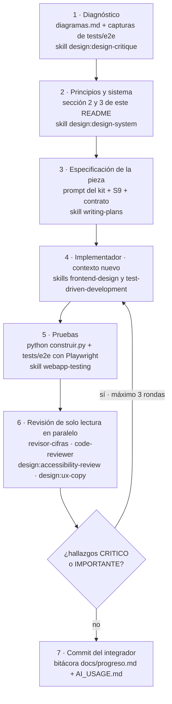

<!-- AI-assisted (Claude Code) — ROOT, NASA Space Apps 2026 -->
# Pase de diseño de ROOT

**Qué es:** el punto de partida del diseño completo de la aplicación. Junta en un lugar el sistema tal como está (diagramas), los principios que ya fijan S9, el kit v4 y `CLAUDE.md`, el sistema visual vigente, lo que se ve en las capturas de hoy y el flujo de trabajo con skills y agentes para continuar.

**Archivos de esta carpeta**

| Archivo | Contenido |
|---|---|
| [`diagramas.md`](diagramas.md) | 19 diagramas Mermaid del sistema actual: contexto, datos, comando único, CI, arquitectura web, navegación, reglas, estados, modelo de datos, pruebas, protocolo y plan del domingo |
| `referencias_github.md` (en preparación) | Repositorios de GitHub con más estrellas para diseño, agentes especialistas y flujos de trabajo, con licencia y qué sirve para ROOT |
| [`escalabilidad.md`](escalabilidad.md) | Qué ya sirve para cualquier suelo y zona, qué sigue atado a Delicias y el diseño de un perfil por distrito |
| [`concepto_visual.md`](concepto_visual.md) | Concepto «el mapa primero» a partir de las referencias del equipo, con dueños y horarios |
| [`prompt_claude_design.md`](prompt_claude_design.md) | Prompt completo para diseñar la aplicación en Claude Design, con las cifras reales de las tres parcelas de la historia |
| [`prototipo_claude_design/`](prototipo_claude_design/README.md) | Prototipo navegable que salió de ese prompt (tema oscuro, una sola pantalla de mapa, capas, ficha, relieve con escurrimiento animado): fuentes del lienzo, tokens, imágenes ilustrativas y sus generadores. Propuesta de diseño; no toca `web/` |
| `README.md` | Este documento |

**Prioridad de documentos:** S9 → kit v4 → S8 (`CLAUDE.md`). Este pase no cambia el alcance, el contrato de datos ni las reglas; si una propuesta las toca, la decide Cristian y se registra en `docs/decisiones/`.

## 1. Restricción de tiempo (S10 §7)
El domingo 15 a las **8:00 se congelan las funciones** y a las **11:00 el código**. Por eso el pase se divide en fases:

| Fase | Cuándo | Qué entra | Riesgo |
|---|---|---|---|
| 0 · Documentar | Ahora | Diagramas, principios, sistema visual vigente, crítica de las capturas, referencias. Solo `docs/` | Ninguno: no toca `web/` |
| 1 · Pulido (kit C5) | Antes de las 8:00, solo con visto bueno de Cristian | Ajustes de jerarquía, textos y accesibilidad **sobre funciones que ya existen**; cada cambio con su prueba y las capturas de `tests/e2e/` | Bajo si se respeta el protocolo de `docs/prompts/` |
| 2 · Rediseño | Después del Open House | Sistema de diseño documentado, componentes, rediseño de la ficha y del centro de control | No aplica al envío del domingo |

## 2. Principios de diseño (vienen de los documentos del proyecto)

| # | Principio | De dónde sale | Cómo se ve en la interfaz |
|---|---|---|---|
| 1 | **La web lee los datos** | `CLAUDE.md` reglas 2 y 3; kit C1 | Ninguna cifra en HTML, JS ni textos fijos; todo valor viene de `web/data/` y tiene su entrada en `manifest.json` |
| 2 | **Decide el agricultor** | Regla 10; S9 §11 | Aviso fijo en la ficha; sin «mejor opción», sin ahorros prometidos, sin «first» ni «only»; la herramienta no reparte, vende ni intercambia agua |
| 3 | **La incertidumbre se ve** | S9 §5 y §6; kit §2.4 | Bandas P10–P90, «at least» con superficie sin clasificar, gris para la abstención, «not run» para lo no ejecutado, etiquetas [V] [P] [S] [NE] |
| 4 | **Nada depende solo del color** | Kit C1 §11 y C2 §2 | Letra, ícono o trama junto a cada color: semáforo (✓ ! ✕ ?), plazo, memoria (P S W D R ?) |
| 5 | **Escala honesta** | S9 §4 bis; S8 decisión 4 | Rótulos «regional, 30 m» o «area scale»; nunca una capa regional presentada por parcela |
| 6 | **Teléfono para el agricultor, escritorio para el técnico y el jurado** | Kit C1 §11, C2, C4 | En pantallas angostas el panel pasa debajo del mapa y la ficha es una hoja inferior; se lee sin zoom |
| 7 | **Movimiento con propósito** | Kit X3.2 | Animación de La gota una sola vez, sin bucles; respeta `prefers-reduced-motion` |
| 8 | **Idiomas** | Regla 9 | Interfaz en inglés; mensaje de WhatsApp en español; sin logotipos de NASA |
| 9 | **Funciona sin red** | Decisión del gemelo digital; S10 §8 | Bibliotecas en `web/vendor/` con hash; app instalable; demo de un solo archivo |

## 3. Sistema visual vigente
Lo que ya existe en `web/style.css` (`:root`). Se documenta aquí como punto de partida; no se cambia en la fase 0.

**Identidad** (kit C1 §10): `--agua`, `--brote`, `--tierra`, `--ambar` y `--arena`, más neutros (`--tinta`, `--tinta-suave`, `--borde`, `--blanco`) y variantes claras y oscuras.

**Familias de color con significado** (cada una con su símbolo o letra):

| Familia | Variables | Valores |
|---|---|---|
| Semáforo de agua | `--sem-verde`, `--sem-ambar`, `--sem-rojo`, `--sem-gris`, `--sem-sin_calculo` | Enough water · Tight · Not enough water · Not classified · clasificada sin opciones |
| Plazo del agua | `--plazo-libre`, `--plazo-por_vencer`, `--plazo-comprometida`, `--plazo-sin_dato` | free · ending soon · committed · no data |
| Memoria de la parcela | `--mem-perenne`, `--mem-verano`, `--mem-invierno`, `--mem-doble`, `--mem-descanso`, `--mem-sin_dato` | P · S · W · D · R · ? |
| Cultivos | `--cul-<cultivo>` | Un color por valor de `cultivo_actual` del contrato |

**Tipografía:** Atkinson Hyperlegible si está instalada en el equipo; si no, la del sistema. Copiarla a `web/vendor/` está pendiente (comentario en `web/index.html`), porque Google Fonts no admite hash de integridad.

**Puntos de quiebre y medios:** pantalla angosta, pantalla baja, impresión y movimiento reducido (`@media` en `web/style.css`). Cada pieza tiene su hoja en `web/css/`.

## 4. Lo que se ve hoy (capturas de `tests/e2e/capturas/`)
Observaciones para discutir, no decisiones. Cada una cita la captura.

| # | Pantalla | Observación | Captura | Fase sugerida |
|---|---|---|---|---|
| 1 | Centro de control, escritorio | La barra de controles ocupa buena parte de la altura cuando «Source and note» y «Units and measuring point» están abiertos; el mapa queda pequeño | `escritorio_centro_control.png` | 1 (plegar por omisión) |
| 2 | Centro de control, «All areas» | Las dos zonas quedan en esquinas opuestas con el centro vacío; el indicador principal tapa parte del mapa | `escritorio_centro_control.png`, `escritorio_dos_zonas_todas.png` | 2 |
| 3 | Ficha, teléfono | Con la ficha abierta, los controles siguen arriba y ocupan buena parte de la pantalla; la ficha empieza a media altura | `telefono_ficha.png` | 1 o 2 |
| 4 | Ficha, orden | La historia del plazo del agua (tarjetas Water · Soil · Money) aparece después de la memoria, el NDVI, el suelo y la evidencia. La frase resumen sí va arriba | `telefono_ficha.png`; diagrama 15 | 2 (reordenar con Cristian: es la pieza que «nunca se corta», S10 §8) |
| 5 | Ficha, jerga | «methods agree: 1/1» y «confidence not available» piden explicación para un agricultor; el glosario existe más abajo | `telefono_ficha.png` | 1 (texto de ayuda junto al dato) |
| 6 | Memoria | La franja combina color y letra y trae leyenda: cumple el principio 4 | `telefono_ficha.png` | — |
| 7 | Indicador principal | «at least», el rango, el aviso de más de 100 % y el enlace a Follow the drop siguen el kit §2.4 | `escritorio_centro_control.png` | — |

## 5. Flujo de trabajo del diseño
El diseño sigue el mismo protocolo que el código (`docs/prompts/README.md`; diagrama 18): especificación → tareas pequeñas → implementador → revisor de solo lectura → corrección (máximo 3 rondas). Lo que cambia es qué skills y agentes intervienen en cada paso.

- Las skills `design:*` vienen del plugin de diseño de esta sesión de Claude Code; las demás están copiadas en `.claude/skills/` y documentadas en su README.
- Los repositorios externos que pueden sumar a este flujo estarán en `referencias_github.md` (en preparación). Ninguno se instala sin el visto bueno de Cristian; si se instala, se copia sin modificar, con su licencia y su sha256, como dice `.claude/skills/README.md`.

## 6. Pendientes y decisiones
| Pendiente | Quién decide | Mientras tanto |
|---|---|---|
| Alcance del pase antes de las 8:00 (fase 1) | Cristian | Solo fase 0 |
| Reordenar la ficha para que las tarjetas vayan antes de la evidencia (observación 4) | Cristian | Orden actual |
| Copiar Atkinson Hyperlegible a `web/vendor/` con licencia y hash | Cristian | Tipografía del sistema |
| Instalar skills o agentes de `referencias_github.md` | Cristian | Solo las ya instaladas |
