<!-- AI-assisted (Claude Code) — ROOT, NASA Space Apps 2026 -->
# Diagramas de ROOT: el sistema tal como está (15-nov-2026)

**Qué es:** el mapa del sistema completo en diagramas Mermaid, hecho a partir de lo que hay en el repositorio: S9 (alcance), S8, S10, el kit v4 (contrato §2, reglas §2.4, pantallas C1–C5 y X3.2), `construir.py`, `motor/`, `web/` y `.github/workflows/publicar.yml`. Es la base del pase de diseño (`docs/diseno/README.md`).

**Reglas de estos diagramas:**
- **No llevan cifras de datos.** Donde el sistema usa un umbral o un parámetro, se nombra su clave de `data/params.json` o su campo del contrato (por ejemplo `memoria.ndvi_verde` o `agua.lamina_bruta`). Así no se desactualizan y cumplen las reglas 2 y 3 de `CLAUDE.md`. Las únicas cifras son versiones de herramientas y horas del plan del evento (S10).
- **Textos de la interfaz en inglés**, tal como aparecen en la página; el resto, en español.
- Si un diagrama y el código difieren, manda el código; si el código y S9 difieren, se anota en la bitácora (`docs/progreso.md`).

**Índice**
1. [Contexto del sistema](#1-contexto-del-sistema)
2. [Flujo de datos de extremo a extremo](#2-flujo-de-datos-de-extremo-a-extremo)
3. [El comando único `python construir.py`](#3-el-comando-único-python-construirpy)
4. [Qué módulo escribe cada archivo de `web/data/`](#4-qué-módulo-escribe-cada-archivo-de-webdata)
5. [Integración continua y publicación](#5-integración-continua-y-publicación)
6. [Arquitectura de la web](#6-arquitectura-de-la-web)
7. [Navegación: las tres pantallas](#7-navegación-las-tres-pantallas)
8. [Secuencia: mover el deslizador](#8-secuencia-mover-el-deslizador)
9. [Reglas por parcela: cobertura, hectáreas y semáforo](#9-reglas-por-parcela-cobertura-hectáreas-y-semáforo)
10. [Indicador principal: agua ya comprometida](#10-indicador-principal-agua-ya-comprometida)
11. [Estado del plazo del agua](#11-estado-del-plazo-del-agua)
12. [La memoria de la parcela](#12-la-memoria-de-la-parcela)
13. [La gota: balance del agua](#13-la-gota-balance-del-agua)
14. [Estados de La gota en la ficha](#14-estados-de-la-gota-en-la-ficha)
15. [Anatomía de la ficha de parcela](#15-anatomía-de-la-ficha-de-parcela)
16. [Modelo de datos (contrato v4)](#16-modelo-de-datos-contrato-v4)
17. [Las cinco pruebas a la vista](#17-las-cinco-pruebas-a-la-vista)
18. [Protocolo de revisión de cada pieza](#18-protocolo-de-revisión-de-cada-pieza)
19. [Plan del domingo (S10)](#19-plan-del-domingo-s10)

---

## 1. Contexto del sistema
Quién usa ROOT, de dónde vienen los datos y por dónde se publica. Fuentes: S9 §3 y §10, `CLAUDE.md` («Operación»), README («NASA Data»).

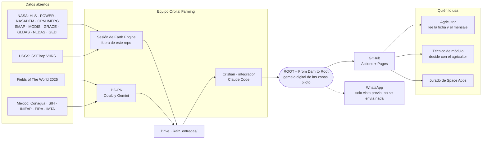

## 2. Flujo de datos de extremo a extremo
Del satélite a la página. Nada entra a `data/processed/` sin pasar el contrato, y nada se publica sin pasar las pruebas. Fuentes: `CLAUDE.md` («Operación», regla 6), kit §2.1, README («Pipeline»).

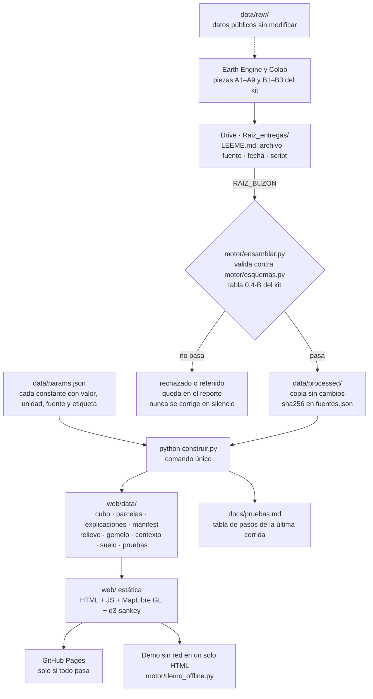

## 3. El comando único `python construir.py`
Orden real de los pasos en `construir.py` → `main()`. Un paso en FALLA hace que el comando salga con código 1 y que GitHub Actions no publique.

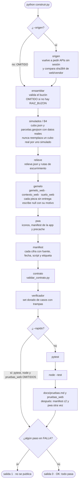

## 4. Qué módulo escribe cada archivo de `web/data/`
Ningún archivo de `web/data/` se escribe a mano (kit §2.5). La web los lee; los opcionales pueden faltar y la página lo dice.

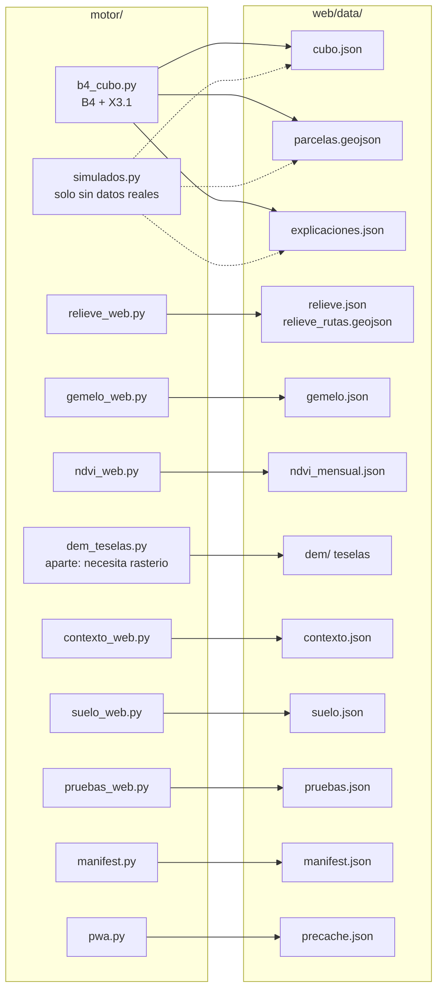

## 5. Integración continua y publicación
`.github/workflows/publicar.yml`. La rama de trabajo nunca publica: solo `main`, y solo con el job de pruebas en verde.

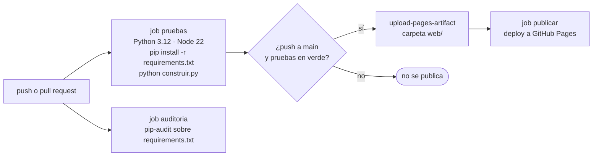

## 6. Arquitectura de la web
Página estática sin frameworks (regla 5). `app.js` coordina; cada pieza vive en su módulo de `web/js/`; las reglas del deslizador viven en **una** función (`web/reglas.js`) que también usan las pruebas.

```mermaid
flowchart TB
  HTML["index.html<br/>estructura y textos fijos, sin cifras"] --> APP
  HTML --> VEN["web/vendor/ con versión fija y sha384<br/>MapLibre GL · d3 · d3-sankey"]
  APP["app.js<br/>estado · controles · mapa · lista · ficha · zonas"] --> RG["reglas.js<br/>cobertura · hectáreas · semáforo<br/>agua comprometida · marcadores"]
  APP --> CC
  APP --> FI
  APP --> AY
  subgraph CC["Centro de control"]
    direction TB
    REL["relieve.js<br/>Terrain & runoff · Simulate a storm"]
    G3D["gemelo3d.js<br/>vista 3D y columnas de agua"]
    TIE["tiempo.js<br/>Observed state by year"]
    EST["estado_gemelo.js<br/>Twin status"]
    CTX["contexto.js<br/>Regional context · GEDI · helada"]
  end
  subgraph FI["Ficha y mensaje"]
    direction TB
    RES["resumen.js<br/>frase · NDVI · enlace #id"]
    SUE["suelo.js<br/>perfil de suelo y aptitud"]
    GOT["gota.js<br/>Follow the drop"]
    MEN["mensaje.js<br/>WhatsApp · Print field sheet"]
  end
  subgraph AY["Ayuda y app"]
    direction TB
    ACE["acerca.js<br/>How it works · About & Data"]
    INS["instalar.js<br/>app instalable"]
  end
  APP --> OBL[("web/data/ obligatorios<br/>cubo.json · parcelas.geojson<br/>explicaciones.json")]
  APP -.-> OPC[("web/data/ opcionales<br/>gemelo · contexto · ndvi_mensual<br/>relieve · suelo · manifest · pruebas")]
  SWK["sw.js<br/>copia sin conexión"] -.-> OBL & OPC
```

## 7. Navegación: las tres pantallas
Las tres pantallas de S9 §3 y sus salidas. La ficha se puede abrir con un enlace directo (`#` + id de la parcela).

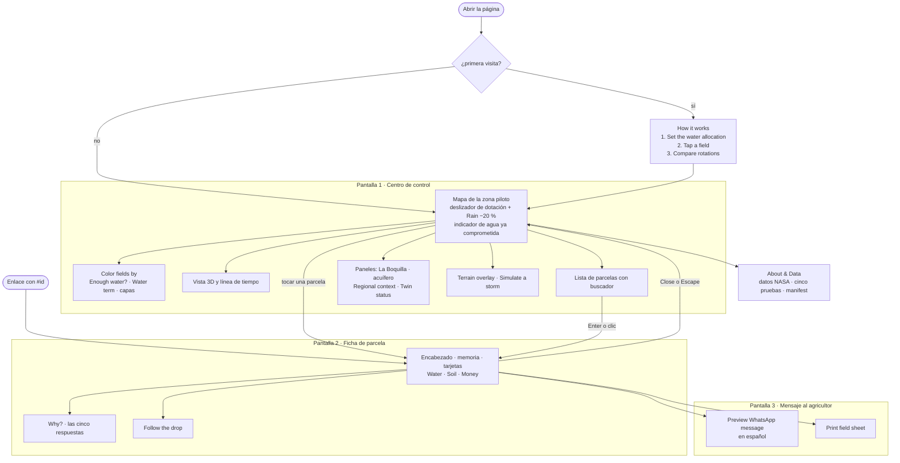

## 8. Secuencia: mover el deslizador
Con cada movimiento la web recalcula todo **sin pedir datos nuevos** (kit C1 paso 4).

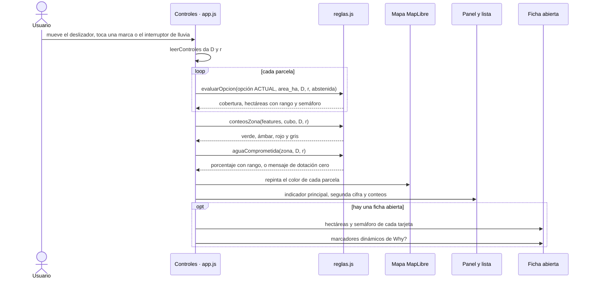

## 9. Reglas por parcela: cobertura, hectáreas y semáforo
Kit §2.4; código en `web/reglas.js` (`cobertura`, `hectareasQueAlcanzan`, `semaforoAgua`, `evaluarOpcion`). D = valor del deslizador; r = lluvia elegida; L10, L50 y L90 = `agua.lamina_bruta[r]` de la opción.

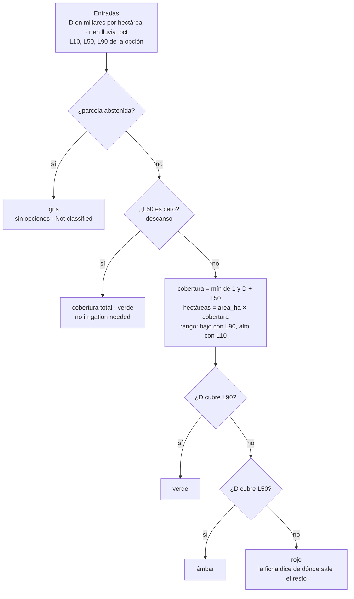

## 10. Indicador principal: agua ya comprometida
Kit §2.4 y C1 paso 5; código en `web/reglas.js` → `aguaComprometida` y `app.js` → `actualizarIndicador`.

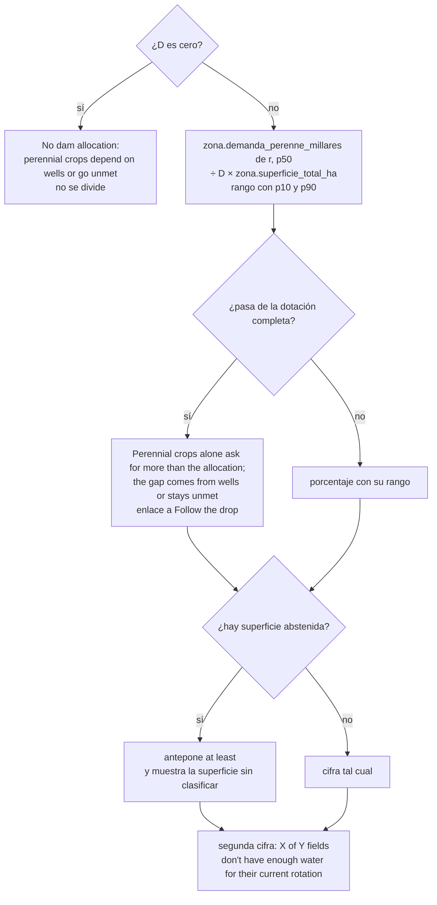

## 11. Estado del plazo del agua
S9 §5 y `motor/b4_cubo.py` (`estado_plazo`). El nogal no descuenta la edad: su compromiso se calcula siempre con `plazo.nogal_horizonte`.

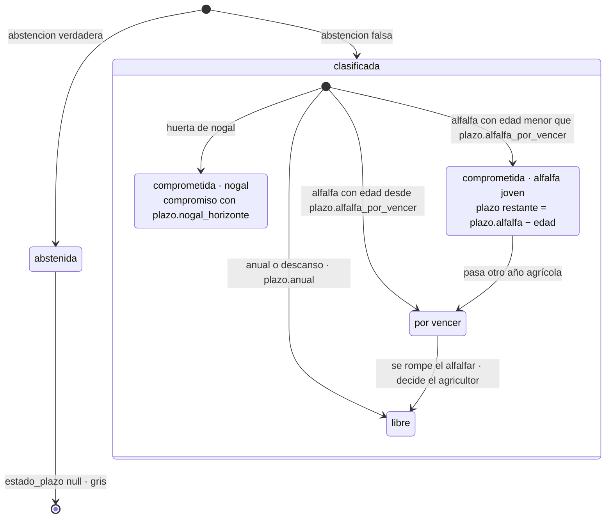

## 12. La memoria de la parcela
Reglas sobre el NDVI mensual de HLS, una celda por año agrícola desde `memoria.anio_inicio` (S9 §5, kit A3-M). Umbrales y ventanas en `data/params.json` → `memoria.*` [S].

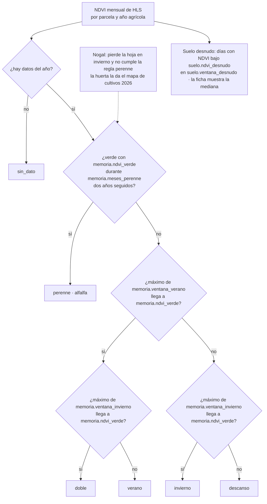

## 13. La gota: balance del agua
X3.1 en `motor/b4_cubo.py` (`flujos_gota`) y bandas del Sankey en `web/js/gota.js` (`bandasGota`). El balance cierra: ET + acuífero + otras = lo que sale de la presa. Se cuenta el consumo, no solo la extracción.

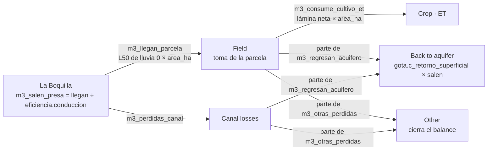

## 14. Estados de La gota en la ficha
Kit X3.2. Con el goteo baja lo que sale de la presa y también lo que regresa al acuífero. Sin eficiencia de goteo con fuente (`eficiencia.goteo`), el botón se muestra como no disponible.

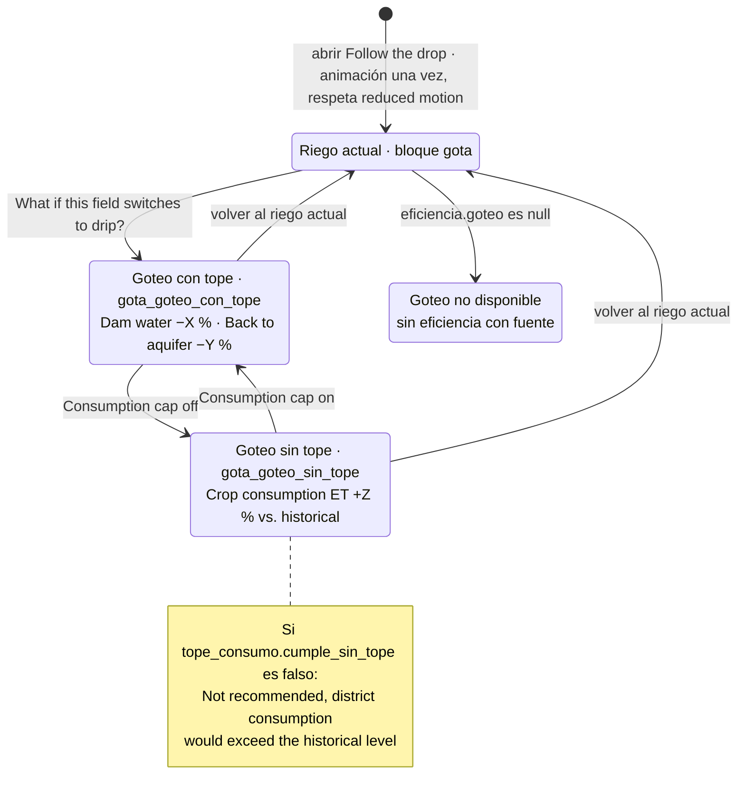

## 15. Anatomía de la ficha de parcela
Orden de los bloques en `app.js` → `construirFicha` (kit C2, X3.2 y C4).

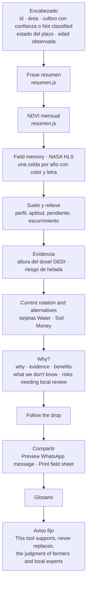

## 16. Modelo de datos (contrato v4)
Kit §2.2–2.5. Se muestran las entidades y los campos que leen las pantallas; el detalle completo está en el kit.

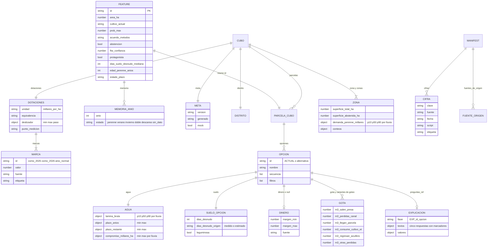

## 17. Las cinco pruebas a la vista
S9 §6. El resultado de cada una se publica, favorable o no, en `web/data/pruebas.json` (lo escribe `motor/pruebas_web.py`) y en About & Data. El estado vigente no se copia aquí: se lee de ese archivo.

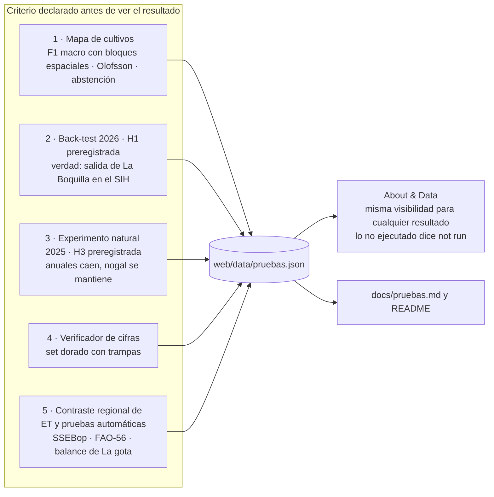

## 18. Protocolo de revisión de cada pieza
`docs/prompts/README.md`. Solo el integrador hace commits; los revisores son de solo lectura y con contexto nuevo.

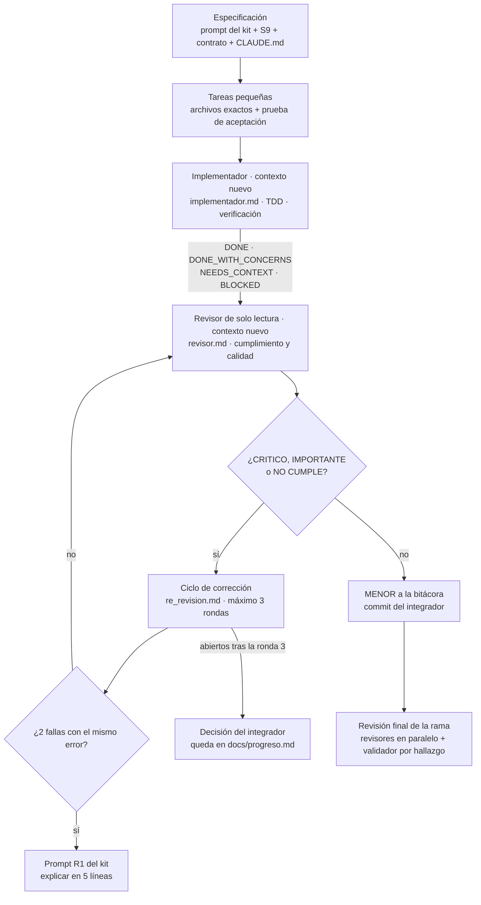

## 19. Plan del domingo (S10)
Horas de S10 §7 (hora de Chihuahua). El orden de corte de S10 §8 manda si hay retraso: nunca se corta la ficha con el plazo del agua y las cinco respuestas, La gota, el aviso de juicio local, el back-test ni el envío.

```mermaid
gantt
  title Domingo 15 de noviembre · hitos de S10
  dateFormat HH:mm
  axisFormat %H:%M
  section Construcción
  Solo C si A y B están listos          :c1, 07:00, 60m
  Funciones congeladas                  :milestone, m1, 08:00, 0m
  Pruebas, cifras con fuente, correcciones :c2, 09:00, 120m
  Código congelado                      :milestone, m2, 11:00, 0m
  section Envío
  Video exportado y probado en incógnito :e1, 11:00, 60m
  Revisión de cifras                    :e2, 12:00, 30m
  Primer envío                          :milestone, m3, 13:00, 0m
  Envío final                           :milestone, m4, 14:30, 0m
  section Presentación
  Montar la mesa y ensayar              :p1, 15:00, 90m
  Open House                            :p2, 17:00, 120m
```
