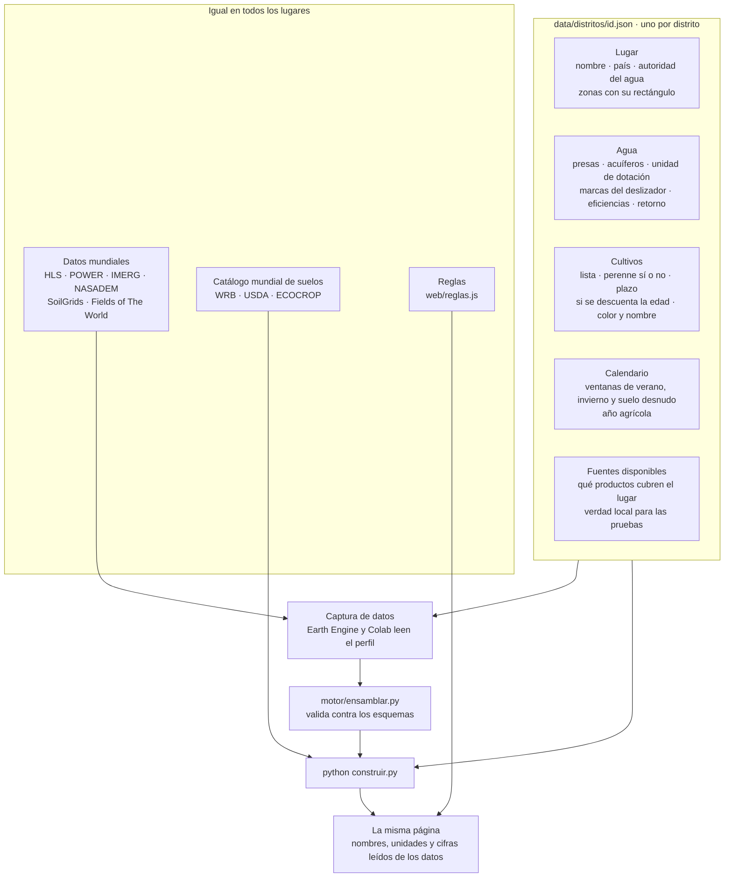

<!-- AI-assisted (Claude Code) — ROOT, NASA Space Apps 2026 -->
# Escalabilidad: otros suelos, otras zonas y otros distritos (15-nov-2026)

**Pregunta:** ¿ROOT sirve para cualquier tipo de suelo y para otros lugares, aunque por ahora solo tengamos datos de Delicias?

**Respuesta corta:**
- **Otras zonas del DR-005: sí, ya funciona.** El motor trabaja por zona y hoy corre con dos zonas piloto.
- **Cualquier tipo de suelo: sí.** El catálogo de suelos es mundial y un dato faltante se muestra como faltante, nunca como cero.
- **Otro distrito u otro país: todavía no.** Es la intención del diseño (S9 §7: «método replicable en cualquier distrito con presa y acuífero, con datos abiertos y un archivo de parámetros por distrito»), pero el contrato v4, varios textos de la página y algunos parámetros siguen escritos para Delicias. La lista exacta está en la sección 2.

Revisión hecha sobre el código de esta rama. Cada fila cita su archivo.

## 1. Lo que ya es genérico

| Pieza | Por qué escala | Dónde se ve |
|---|---|---|
| Zonas | Las zonas son una lista en `data/params.json` → `zona_piloto.zonas` (id, nombre, prefijo, rectángulo). El motor lee los archivos de cada zona con el sufijo `_<zona>` y cada parcela usa la lámina de su propia zona | `motor/b4_cubo.py`, `motor/ensamblar.py`, `motor/relieve_web.py`, `motor/dem_teselas.py`; pruebas con dos zonas en `tests/test_b4.py` y `tests/fixtures/buzon_dos_zonas/` |
| Reglas de la página | Cobertura, hectáreas, semáforo y agua comprometida dependen solo de la dotación, la lámina P10–P50–P90 y la superficie; no nombran ningún lugar | `web/reglas.js` |
| Suelo | Catálogo mundial: los grupos de referencia de WRB y los órdenes de USDA completos. Requisitos de cultivo de FAO ECOCROP (rangos mundiales). Reglas de pH, materia orgánica, CIC, carbonatos y salinidad sin lugar fijo. Sin dato: «not in the map» | `data/processed/suelo_tipos.json` (`wrb`, `usda_ordenes`), `data/processed/suelo_requisitos.json`, `data/processed/suelo_reglas.json`, `web/js/suelo.js` |
| Datos de satélite y clima | HLS, NASA POWER, GPM IMERG, NASADEM, SMAP, MODIS, GRACE, GLDAS, SSEBop, Fields of The World y SoilGrids son productos de cobertura mundial o casi mundial | README, «NASA Data» |
| Cultivos nuevos en la página | Un cultivo que la página no conoce se muestra con su clave y en gris; no rompe la página | `web/app.js` → `nombreCultivo` y `colorCSS` |
| Comando único y pruebas | `python construir.py` no depende del lugar: valida, calcula y prueba lo que haya en `data/processed/` | `construir.py` |

## 2. Lo que está atado a Delicias

| # | Qué | Dónde | Qué haría falta para otro distrito |
|---|---|---|---|
| 1 | La presa y el acuífero tienen nombre propio en el contrato: `distrito.boquilla` y `distrito.acuifero_0831` | `motor/b4_cubo.py`, `motor/ensamblar.py`, `motor/manifest.py`, `motor/simulados.py`, kit §2.3 | Campos genéricos (`distrito.presas[]`, `distrito.acuiferos[]`) con nombre y fuente. **Cambia el contrato v4: lo autoriza Cristian** (regla 1) |
| 2 | Textos fijos con el nombre de la presa y de la autoridad: «La Boquilla dam», «La Boquilla (dam)» en La gota, «la asignación oficial la decide Conagua» en WhatsApp | `web/index.html`, `web/js/gota.js`, `web/app.js` (texto de La gota), `web/js/mensaje.js` | Que esos nombres vengan del perfil del distrito, como ya vienen las cifras |
| 3 | Lista cerrada de cultivos (los de Delicias) | `validar_contrato.py` → `CULTIVOS`; `motor/esquemas.py` → `CLASES_ETIQUETA` | Lista de cultivos por distrito, con su color y su nombre en el perfil |
| 4 | Solo dos perennes, escritos en el código: alfalfa y nogal; plazos solo `alfalfa`, `nogal` y `anual` | `motor/b4_cubo.py` (perennes y plazo), `motor/esquemas.py` → `PLAZOS_ROTACION`, `data/params.json` → `plazo` | Tabla de cultivos con `perenne` sí/no, plazo y si se descuenta la edad; así entran vid, cítricos, aguacate o caña sin tocar código |
| 5 | Calendario del hemisferio norte y de un clima árido: ventanas de verano e invierno de la memoria y ventana del suelo desnudo, únicas para todas las zonas | `data/params.json` → `memoria.ventana_verano`, `memoria.ventana_invierno`, `suelo.ventana_desnudo` | Ventanas por zona o por distrito (en el hemisferio sur se invierten; en el trópico cambian las temporadas) |
| 6 | Dotaciones y su unidad: las marcas del deslizador salen de la prensa de Delicias y la unidad es el millar por hectárea | `data/params.json` → `dotaciones` | Marcas y unidad por distrito (m³/ha, mm, acre-feet), con la conversión en el perfil |
| 7 | Eficiencia de conducción y coeficientes de retorno de un solo lugar (IMTA para el DR-005; Conagua para el acuífero 0831) | `data/params.json` → `eficiencia`, `gota` | Valores por distrito con su fuente; null y aviso donde no haya dato |
| 8 | Zona por omisión `delicias_saucillo` (archivos sin sufijo) | `motor/b4_cubo.py`, `motor/esquemas.py`, `motor/relieve_web.py`, `motor/dem_teselas.py` | Que todas las zonas usen sufijo; queda por compatibilidad con las entregas de la primera zona |
| 9 | Scripts de captura con los rectángulos de las zonas escritos en el script | `datos/earthengine/A3_hls_nasadem.js` (`ZONAS`) | Que lean los rectángulos de `data/params.json`. Esos scripts los corre la otra sesión: aquí no se editan (`CLAUDE.md`, «Operación») |
| 10 | Referencias locales: porcentajes de suelo del municipio de Delicias y la verdad del back-test (SIH, La Boquilla) | `data/processed/suelo_tipos.json` → `zona`; prueba 2 | Son propias de cada lugar: cada distrito trae las suyas o se marca «not run» |
| 11 | Algunas fuentes no son mundiales: NLDAS solo cubre Norteamérica y la cobertura de GEDI no llega a latitudes altas | README, «NASA Data» | Marcar «not available here» cuando la zona queda fuera |

## 3. Diseño propuesto: un perfil por distrito
Todo lo que hoy es de Delicias pasa a un archivo de perfil; el código y las reglas no cambian de un lugar a otro.

## 4. Orden sugerido
| Paso | Qué | Cuándo |
|---|---|---|
| 1 | Este documento y la decisión de Cristian sobre el contrato | Ahora |
| 2 | Para el pitch: decir que funciona en dos zonas del DR-005 y que otro distrito necesita su perfil (S9 §7). No decir que ya funciona en cualquier lugar | Domingo, en textos y exposición |
| 3 | Perfil de distrito con los valores actuales de Delicias, sin cambiar resultados: las pruebas deben dar lo mismo | Después del evento |
| 4 | Nombres de presa, acuífero y autoridad desde el perfil (sección 2, filas 1 y 2); tabla de cultivos (filas 3 y 4) | Después del evento |
| 5 | Calendario por zona (fila 5) y prueba con un distrito del hemisferio sur o del trópico, con datos simulados rotulados | Después del evento |
