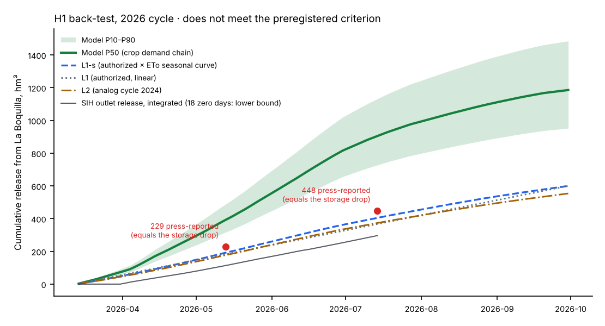

<!-- AI-assisted (Claude Code) — ROOT, NASA Space Apps 2026 -->
# H1 result · back-test of the 2026 cycle (DR-005, La Boquilla)

English translation of [docs/resultado_H1.md](../resultado_H1.md); if they differ, the Spanish original prevails.

**H1: does not meet the preregistered criterion.** At the main point (14-Jul-2026) the model's error is larger
than that of L1-s and that of L1. It is published as it came out.

**Source of truth used:** 447.65 hm³ from the press, labelled "press-reported; equals the storage drop". The official
SIH series has 18 days with zero in the period (14 to 31 of March), so the fallback that the preregistration
already provided for applies. The integrated SIH output (296.31 hm³) is reported alongside; it is a floor (`docs/h1_verdad_sih.md`).

## Main point, 14-Jul-2026 (cumulative hm³ since 14-Mar)
| | Estimate | Error against press (447.65) | Error against SIH (296.31) |
|---|---|---|---|
| **Model, P50 (P10–P90)** | **904.6** (727.2–1131.4) | **456.9** | 608.2 |
| L1-s (authorized × ETo curve) | 404.5 | 43.2 | 108.1 |
| L1 (authorized, linear) | 367.2 | 80.5 | 70.9 |
| L2 (analog cycle 2024) | 373.3 | 74.3 | 77.0 |

- Model skill (1 − model error ÷ baseline error), with the press truth: -9.58 against L1-s, -4.68 against L1 and -5.15 against L2. A negative skill means the baseline was closer.
- The truth falls **outside** the model's P10–P90 interval.
- Consistency point (13-May, does not decide): model 391.9 (316.4–487.6); L1-s 191.8; L1 182.1; press 228.86; SIH 113.36. Same direction.
- With a single cycle, accuracy or significance are not discussed.

## Why it fails: the level, not the shape
- The model computes the **full** crop demand: for the whole cycle it gives 1185.7 hm³ at the dam attributable to La Boquilla, almost double the 600 hm³ authorized. The resulting depth at the dam is around 2.8 m, against 1.514 m historical median in the Conagua series (27 years with delivery).
- That is: the district operates with much less water than the FAO-56 ÷ field efficiency ÷ conveyance efficiency chain assumes necessary. It points in the same direction as the ET contrast (A8: the modelled ETc exceeds SSEBop ET by 53 %) and as Villalobos-Cano et al. 2024 (ET ÷ applied water = 65.6 % in alfalfa). It does not distinguish between irrigation below demand, real efficiencies higher than assumed, well water or reuse.
- **"Anchored" variant (sensitivity declared before running; does not decide):** if the model's total is set equal to the total of L1 and only the shape within the cycle is compared, the model gives 457.7 hm³ on 14-Jul: it is 10.1 hm³ from the press figure, closer than L1-s (43.2) and than L1 (80.5). Against the SIH integral it does not improve on the baselines. In 2026 the shape came close to the press figure; the level did not. Whether the shape works in general was tested separately and does not hold (next point).

- **The shape does not hold in other years either (H1-b, new test of 14-Nov, `docs/resultado_H1b.md`):** it was tested whether that
  shape describes the 1999–2024 cycles. It does not: the model beats the simple shapes in 6 of 26 years and brings demand forward (it gives
  76 % of the cycle by 14-Jul; the observed is 68 %). The closeness of 2026 was a one-year event. The shape that best follows the dam
  is the simplest one: the NASA POWER ETo curve (median error of 3.3 percentage points).

## Sensitivities (declared before running; none changes the main verdict)
| Variant | Model P50 (P10–P90) | L1-s | L1 | With press | With SIH |
|---|---|---|---|---|---|
| Authorized of 500 hm³ | 753.8 (606.0–942.8) | 337.0 | 306.0 | does not meet | does not meet |
| L1 fraction = 1.15 | 904.6 (727.2–1131.4) | 465.2 | 422.4 | does not meet | does not meet |
| End of cycle on 31-Oct | 904.6 (727.2–1131.4) | 368.7 | 318.1 | does not meet | does not meet |
| Crop pattern 2024-25 | 969.9 (777.0–1217.8) | 404.5 | 367.2 | does not meet | does not meet |
| Crop pattern 2016-17 | 894.4 (718.9–1118.8) | 404.5 | 367.2 | does not meet | does not meet |
| Model anchored to the L1 total (shape only) | 457.7 (456.6–458.9) | 404.5 | 367.2 | meets | does not meet |

## How it was done
- Script `datos/colab/A6_backtest.py`; outputs `h1_resultado.json`, `h1_series.csv`. Monte Carlo of 10,000 runs; NASA POWER climatology 1991–2025.
- Derived authorized area: 42,937 ha (650 hm³ ÷ median historical gross depth). 2023-24 crop pattern from Conagua: alfalfa 41%, pecan 27%, forage maize 10%, chile 6%, cotton 0.7%, others 16%.
- L2: the analog cycle is 2024 (storage on 14-Mar of 1082.085 hm³, equal to that of 2026 in the SIH series); output of that cycle, 553.8 hm³.
- Not applied: Kc draw, leaching fraction and calibration against previous cycles.

## Deviations and limits (section 10 of the preregistration)
1. **Points that the preregistration left pending** (climatology period, authorized area, crop pattern, L1 fraction, efficiency ranges): they were fixed in `docs/h1_especificacion_operativa.md`, uploaded to the repository at 14:11 on 14-Nov, **before** running the model. The session that did the analysis did not have the published version of the preregistration in view; if that version fixes something different, it prevails and the analysis is repeated.
2. **Results known in advance:** the press figures and the SIH series were already known when the specification was fixed.
3. The press figure equals the storage drop (447.99 hm³ in the official series): it includes evaporation and inflows, it is not measured extraction. The SIH integral omits 18 days. The real extraction must lie between the two.
4. It is not known whether the figures include deliveries outside DR-005. The official close of the 2026 cycle is not published: this is a **partial back-test**.
5. Crops without a Kc in the model (16% of the area: peanut, onion, melon, watermelon and others) were assigned the mean depth of the modelled annuals.

Label for the page: "H1 does not meet the preregistered criterion (partial back-test; press-reported truth)".
