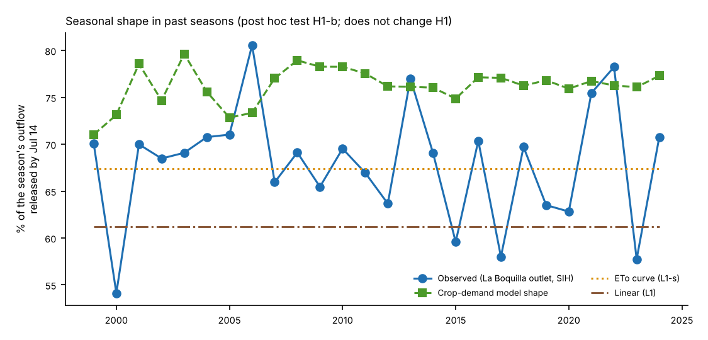

<!-- AI-assisted (Claude Code) — ROOT, NASA Space Apps 2026 -->
# H1-b result · seasonal shape in earlier cycles (1999–2024)

English translation of [docs/resultado_H1b.md](../resultado_H1b.md); if they differ, the Spanish original prevails.

**H1-b does not hold.** The seasonal shape of the demand model does **not** describe the output of La Boquilla better than
the simple shapes. It is published as it came out. **It does not change H1**, which remains *does not meet the preregistered criterion*.

New test (post hoc), defined in `docs/h1b_especificacion.md` and uploaded to the repository (commit `695caf8`, 14-Nov-2026,
16:20; the text of the specification says 16:30, the commit time is the one that counts) **before** computing anything.
Script: `datos/colab/A6b_forma_historica.py`; data: `h1b_anios.csv`, `h1b_resultado.json`.

## Result
| | Demand model | L1-s (NASA POWER ETo curve) | L1 (linear) |
|---|---|---|---|
| Fraction of the cycle it gives by 14-Jul | 71–80 % depending on the crop pattern | 67.4 % | 61.2 % |
| Median error (percentage points, 26 years) | **8.66** | **3.34** | 7.9 |

- Condition 1 (the model beats both simple shapes in more than half of the years): **no**. It wins in 6 of 26.
- Condition 2 (median error of the model lower than the other two): **no**.
- Sign test, descriptive only: 0.9988.

## What it says
- On average, by 14 July 68.0 % of the cycle's water has already left. The demand model says 76.2 %: it **brings forward**
  demand (asks for more water in spring than the dam delivers). The ETo curve gives 67.4 %.
- The closeness of the "anchored" variant in 2026 (457.7 against 447.65 hm³) **does not repeat** in earlier years: it was
  one year, not a rule. This is stated in `docs/resultado_H1.md`.
- What the data do support, as a **description** and not as a registered hypothesis: the simplest shape —cycle
  volume distributed with the NASA POWER climatological ETo curve— is the one that best follows the dam's output:
  median error of 3.34 points, better than the linear one in 19 of 26 years and the best of the three in 13 (its error reaches 13.3 points in the worst year).
- Observation without a test (seen after running): the 6 years in which the model wins are among the 10 cycles with the least
  water (less than 530 hm³ of output) and it does not win in any of the other 16; in low-water cycles the dam delivers
  earlier (73.1 % by 14-Jul against 64.8 % in the rest). It is a lead for another test, not a result.

## Sensitivities (declared before running; they do not decide)
| Variant | Years in which the model wins | Model median | L1-s median | L1 median | H1-b |
|---|---|---|---|---|---|
| Crop pattern of the same year | 6 of 26 | 7.57 | 3.34 | 7.9 | does not hold |
| Cutoff on 13 May | 9 of 26 | 3.46 | 3.27 | 2.85 | does not hold |
| End of cycle on 31 October | 13 of 26 | 6.71 | 7.11 | 15.19 | does not hold |
| Without years with 10 or more days of zero output (Apr–Aug) | 5 of 25 | 8.74 | 3.34 | 7.89 | does not hold |

## By year
| Year | Cycle output (hm³) | Observed by 14-Jul | Model | Model error (pp) | L1-s error (pp) | L1 error (pp) | Does the model win? |
|---|---|---|---|---|---|---|---|
| 1999 | 361 | 70.1 % | 71.0 % | 0.97 | 2.65 | 8.86 | yes |
| 2000 | 699 | 54.1 % | 73.1 % | 19.01 | 13.29 | 7.07 | no |
| 2001 | 439 | 70.0 % | 78.6 % | 8.58 | 2.58 | 8.8 | no |
| 2002 | 413 | 68.5 % | 74.7 % | 6.18 | 1.07 | 7.29 | no |
| 2003 | 410 | 69.1 % | 79.6 % | 10.54 | 1.68 | 7.89 | no |
| 2004 | 306 | 70.8 % | 75.6 % | 4.83 | 3.35 | 9.57 | no |
| 2005 | 431 | 71.0 % | 72.8 % | 1.82 | 3.62 | 9.83 | yes |
| 2006 | 523 | 80.6 % | 73.4 % | 7.22 | 13.16 | 19.37 | yes |
| 2007 | 676 | 66.0 % | 77.0 % | 11.07 | 1.46 | 4.76 | no |
| 2008 | 698 | 69.1 % | 79.0 % | 9.84 | 1.71 | 7.92 | no |
| 2009 | 771 | 65.5 % | 78.3 % | 12.81 | 1.95 | 4.27 | no |
| 2010 | 783 | 69.5 % | 78.3 % | 8.74 | 2.12 | 8.33 | no |
| 2011 | 845 | 67.0 % | 77.5 % | 10.59 | 0.44 | 5.77 | no |
| 2012 | 875 | 63.7 % | 76.2 % | 12.49 | 3.73 | 2.48 | no |
| 2013 | 468 | 77.0 % | 76.1 % | 0.86 | 9.58 | 15.79 | yes |
| 2014 | 559 | 69.1 % | 76.0 % | 6.98 | 1.65 | 7.86 | no |
| 2015 | 760 | 59.6 % | 74.9 % | 15.29 | 7.83 | 1.62 | no |
| 2016 | 758 | 70.4 % | 77.1 % | 6.77 | 2.96 | 9.18 | no |
| 2017 | 986 | 58.0 % | 77.1 % | 19.07 | 9.4 | 3.18 | no |
| 2018 | 738 | 69.7 % | 76.2 % | 6.54 | 2.3 | 8.51 | no |
| 2019 | 854 | 63.5 % | 76.8 % | 13.32 | 3.9 | 2.31 | no |
| 2020 | 871 | 62.8 % | 75.9 % | 13.1 | 4.58 | 1.63 | no |
| 2021 | 356 | 75.5 % | 76.7 % | 1.29 | 8.05 | 14.26 | yes |
| 2022 | 446 | 78.2 % | 76.3 % | 1.97 | 10.83 | 17.04 | yes |
| 2023 | 767 | 57.8 % | 76.1 % | 18.34 | 9.66 | 3.44 | no |
| 2024 | 554 | 70.8 % | 77.3 % | 6.55 | 3.34 | 9.55 | no |

## Limits
- The years are not independent (same climatology; the crop pattern changes slowly). Significance is not discussed.
- The 1991–2025 climatology includes the evaluated years; it affects the model and L1-s equally.
- The dam's output also responds to operating decisions (irrigation calendar, maintenance), not only to demand.
- The SIH series may contain zeros that are gaps (2022 has 12 days with zero from April to August).
