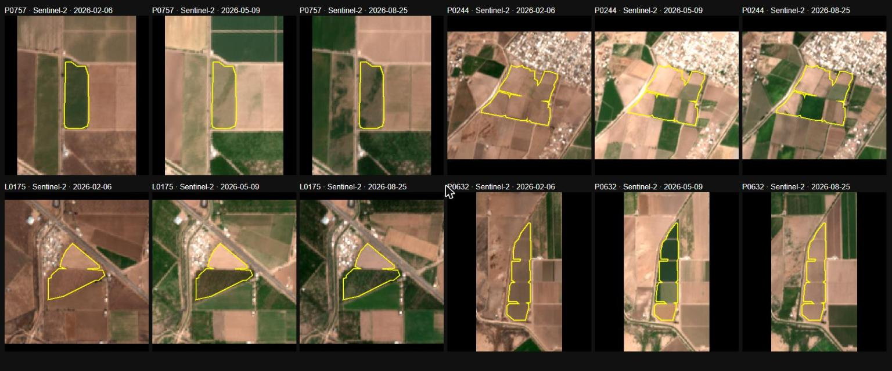

<!-- AI-assisted (Claude Code) — ROOT, NASA Space Apps 2026 -->
# Review of the story fields in true color (kit B1, step 4)

English translation of [docs/revision_protagonistas.md](../revision_protagonistas.md); if they differ, the Spanish original prevails.

**Review date:** 14-Nov-2026, 15:50 (Chihuahua time).
**Reviewed by:** the data session (AI assistant), looking at the images. **It does not replace the review by a person
on the team who knows the area**, which is still pending; the kit marks it as a mandatory manual review.
**Images:** Sentinel-2 L2A in true color (bands B4, B3, B2), collection `COPERNICUS/S2_SR_HARMONIZED` in Google Earth
Engine (project iondroplet), tile T13RDM, the scene with the fewest clouds of each period:

| Date | Scene | Clouds in the scene |
|---|---|---|
| 6-Feb-2026 | `20260206T174419_20260206T174757_T13RDM` | 0 % |
| 9-May-2026 | `20260509T172901_20260509T174413_T13RDM` | 0.1 % |
| 25-Aug-2026 | `20260825T173859_20260825T175354_T13RDM` | 0 % |

Figure: `docs/figuras/protagonistas_sentinel2_2026.jpg` (field outline in yellow; contains modified Copernicus
Sentinel data, 2026). It is compared against the monthly HLS NDVI in `hls_mensual_parcelas.csv` and against the GEDI height
in `gedi_parcelas.csv`.

*Contains modified Copernicus Sentinel data 2026.*

| Field | What the system says | What is seen | Does it match? |
|---|---|---|---|
| **P0757** (7.95 ha, next to Km 92) | 3-year-old alfalfa, "about to expire" | A single rectangular, well-delimited field. Dark green in February, pale green in May (looks freshly cut) and irregular green in August. NDVI between 0.49 and 0.84 in all 12 months. GEDI: 11 shots, median 2.9 m (no trees) | **Yes.** Crop green all year, no tall canopy: compatible with alfalfa. The outline matches the field |
| **P0244** (27.97 ha, next to El Molino) | Fallow in 2026, "free" | The polygon **groups about 7 small fields** adjoining the village. In February all of them are uncropped; in May and August 2 or 3 of them (around a quarter of the area) are green and the rest remains uncropped. Median NDVI of 0.19 to 0.31, with the upper quartile up to 0.62 from May to September | **Partly.** Most of the polygon was indeed fallow, but it is not a single field and it was not all uncropped. The Fields of The World outline does not separate the fields |
| **L0175** (10.76 ha, Lázaro Cárdenas) | Pecan orchard, "committed" | Two parts: below (nearly two thirds) an orchard with tree texture, leafless in February and dark green in May and August; above, a triangle of uncropped soil all year. GEDI: 3 shots, median 13.6 m | **Yes for the orchard.** The outline also includes an uncropped lot: the real pecan area is smaller than the 10.76 ha of the polygon |

## A "free" field that does show water (integrator's request)
P0244 is "free", but its current option is fallow: depth 0 and La gota (the drop graphic) with no flow. Candidates with an annual crop in 2026
(class `cereal_invierno`, status "free"), with Fields of The World confidence and size similar (P0244: 56 and 28 ha):

| Field | Area | FTW confidence | Distance | What is seen | Recommendation |
|---|---|---|---|---|---|
| **P0632** | 20.66 ha | 54 | 3.2 km from Km 92 | Strip of 5 contiguous plots with the same management: sprouts in February (NDVI 0.46), full green in March and April (0.86–0.90, quartiles 0.81–0.90: homogeneous), harvested in May and uncropped in summer. Record: summer crop from 2019 to 2025 and winter crop in 2026. GEDI: 20 shots, no tall canopy | **Preferred choice.** It is the most homogeneous |
| P0605 | 31.91 ha | 55 | 3.0 km from Km 92 | Combines two managements: two thirds with late-winter cereal (green from March to May) and one third with a summer crop (green in August) | Second choice: mixed polygon |
| P0742, P0683 | 169 and 178 ha | 56 and 55 | 1.6 and 1.9 km from Km 92 | Fields of The World polygons that group many fields | No: they are not a single field |

Note on the class: what the rules call `cereal_invierno` in these fields is a late-winter and spring crop
(green from February to April or May). The name of the crop cannot be confirmed from the image.

**Update, 14-Nov 16:28:** by decision of the integrator (`docs/decisiones/2026-11-14_opciones_b3.md` in their branch), the "free" story field becomes **P0632** and P0244 stops being one (it stays on the map like any other field). `parcelas_base.geojson` was regenerated with the marks P0757, P0632 and L0175. The review of P0632 is the one in the table above and is worth the same as the others: done by the data session on Sentinel-2; the one by a person is missing.

## What is missing
- That a person on the team who knows Km 92, El Molino and Lázaro Cárdenas confirms the crop of these fields.
- If the outline of P0244 and L0175 is to be corrected, it has to be drawn by hand (the kit provides for it); this was not done.
