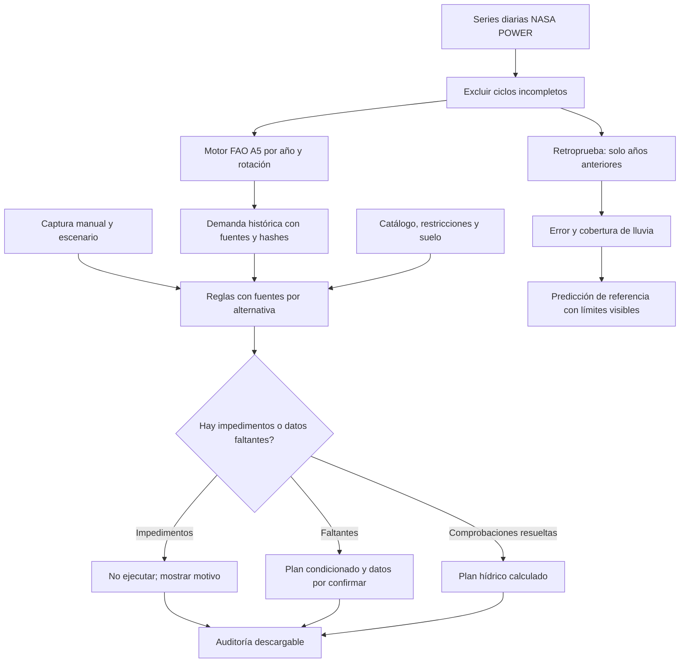

<!-- AI-assisted (Claude Code) — ROOT, NASA Space Apps 2026; implementación con Codex. -->
# Recomendaciones calculadas, datos manuales y pronóstico verificable

Esta entrega sustituye las tres tarjetas genéricas por un motor de planificación hídrica por alternativa. No es un modelo de rendimiento ni una certificación de aptitud agronómica. Los datos vacíos permanecen desconocidos y las restricciones sin resolver se muestran, no se dan por aprobadas.

## Qué calcula y de dónde sale

`motor/pronostico_web.py` lee los CSV diarios `eto_diaria.csv` y `eto_diaria_lazaro_cardenas.csv`, los parámetros de `rotaciones*.json`, el catálogo `opciones_b3.json`, `supuestos.json` y `suelo_requisitos.json`. Reutiliza `datos/colab/A5_demanda_plazo.py` para obtener ETc y lámina neta por rotación, año y escenario de lluvia. Crea una instancia y una caché separadas por zona. No ejecuta Earth Engine ni consulta una API privada.

La aplicación consume `web/data/pronostico.json`. Sus fuentes incluyen hashes SHA-256 de datos y código. Las cifras publicadas también se incorporan a `manifest.json`. Cambiar las series y reconstruir cambia las predicciones; cambiar una entrada en el navegador vuelve a ejecutar las reglas. No hay respuestas por parcela escritas a mano ni una llamada a un LLM que invente la recomendación.

Para cada ciclo completo:

- `ETc = Kc × ETo`, con curvas y fechas base del motor existente.
- `neta = suma mensual de max(ETc − lluvia efectiva, 0)`.
- `bruta = (neta / eficiencia + presiembra de anuales) / 100`, en millares/ha.
- `presupuesto = dotación × superficie`; si se captura volumen disponible, `presupuesto = volumen_m3 / 1000` y no se suma otra vez la dotación.
- `área del plan = min(superficie, presupuesto / cuantil conservador de demanda)`.

Se mantienen los parámetros Kc y de presiembra existentes y se declara su origen. La nueva distribución no aplica el sesgo aleatorio de ETo del Monte Carlo anterior: usa la ETo de la serie y muestra esta diferencia metodológica. Por ello puede diferir del P50 del dashboard original.

El usuario elige un nivel histórico de planificación. Con eficiencia no medida, el cuantil del plan utiliza el extremo de mayor demanda del rango declarado. Las bandas combinan variabilidad climática y sensibilidad a eficiencia/presiembra; **no son intervalos calibrados de confianza en el rendimiento**. La frecuencia de años en que alcanza el agua no es probabilidad de cosecha.

## Cómo se emite una recomendación

El motor `web/js/recomendador.js` tiene funciones puras y pruebas independientes. Evalúa la rotación actual y las alternativas permitidas por el catálogo; el usuario puede añadir un candidato explícito. No presenta todos los cultivos como si fueran alternativas ya aprobadas para una huerta.

Cada resultado contiene una acción calculada, área máxima del plan, demanda, presupuesto, frecuencia histórica y evidencias con fuente. No usa una suma arbitraria de puntos para declarar un cultivo «mejor». Los estados son:

- **Con impedimentos:** no ejecutar mientras exista el conflicto. Incluye chile después de chile, fecha fuera de una ventana documentada, sustitución de nogal dentro de este modelo y edad insuficiente para corte de alfalfa.
- **Condicionado:** el cálculo de agua existe, pero faltan confirmaciones o hay limitantes que requieren evaluación local.
- **Plan hídrico calculado:** las comprobaciones implementadas se resolvieron con las entradas disponibles. No implica validación integral de manejo, precio, producción o rentabilidad.

Se compara ECe del suelo con los umbrales y fuentes existentes de FAO-29. Superar el umbral provoca una condición de revisión; no se interpreta como imposibilidad absoluta de cultivar. El pH y la textura regionales son orientación y no descartan por sí solos. Los antecedentes de atrazina, fitopatología, restablecimiento de alfalfa y requisitos incompletos permanecen pendientes cuando no pueden resolverse con las entradas. No se completa salinidad con cero.

La fecha manual **valida la ventana del primer cultivo**, pero **no desplaza la curva diaria de demanda A5**. Las fechas base usadas para cada alternativa están visibles en las evidencias. Una rotación múltiple necesita confirmar las siembras posteriores. Para fechas distintas, riego diario o déficits por etapa se necesita extender el modelo y validarlo; no se presenta esa capacidad como implementada.

Cereal de invierno sigue siendo una categoría observada por satélite; el representante del modelo es avena forrajera. No certifica la especie sembrada ni su riego local en Delicias. Barbecho es una posible interpretación de baja vegetación, no prueba de un descanso agrícola deliberado.

## Captura manual y contraste

La vista permite registrar cultivo previo, candidato, área, volumen disponible, sistema de riego, eficiencia medida, fecha, pH, ECe, antecedentes y edad de alfalfa. El sistema de riego no se infiere por la geometría del mapa: se muestra como sin registrar hasta capturarlo. Si no hay eficiencia medida se usa una referencia o rango explícito con fuente, manteniendo su condición de valor no medido.

La captura queda en memoria durante la sesión y se conserva al alternar parcelas. Se puede descargar como JSON. La auditoría incluye entradas, series por año, cálculo, decisiones, impedimentos y hashes. No se envían mediciones a un servidor.

Para comprobar el modelo con un registro propio se captura ciclo y volumen aplicado. Se muestra modelo contra volumen reportado y diferencia en m³. Exige la misma superficie, cultivo, calendario y periodo. Una sola observación **no calibra ni valida** la demanda; el registro del usuario tampoco se verifica automáticamente. Si solo se captura el año o solo el volumen, se solicita completar el par. Las entradas inválidas eliminan las recomendaciones anteriores para no exportar un resultado obsoleto.

## Predicción de lluvia y helada

La referencia de lluvia es una distribución empírica de ciclos agrícolas completos, de octubre a septiembre, de NASA POWER. No es un pronóstico meteorológico diario, de presa ni de producción. Tampoco incorpora observaciones parciales del ciclo objetivo. Los ciclos con un solo día no válido se excluyen y se informa cuántos días faltan.

La retroprueba usa origen expansivo: tras los primeros diez ciclos, para predecir cada año solo utiliza los anteriores. Publica cada predicción, la lluvia registrada, el error, la cobertura y una comparación contra repetir el año anterior. No selecciona el método por el resultado del último año ni utiliza el año objetivo al calcular sus cuantiles. La persistencia es una referencia sencilla, no una demostración de superioridad ante todos los modelos.

En esta caché hay 34 ciclos completos por zona, de 1992 a 2025, y 24 años de prueba. El ciclo 2026 se excluye porque falta un día válido (7 de septiembre); no se interpola para completar resultados. La referencia de la pantalla corresponde al ciclo 2027 con ese histórico disponible. La estabilidad de la distribución climática es una hipótesis, no una garantía ante cambio climático.

Para chile, la fecha manual consulta la frecuencia de heladas desde ese día hasta fin de junio, calculada directamente de Tmin de los ciclos completos de la zona. Se muestran casos y denominador. No se inventa un umbral de riesgo aceptable y cero casos observados no significa ausencia de riesgo futuro. NASA POWER representa una celda regional; faltan validaciones con estación local y microclima.

## Prueba manual reproducible

1. Abrir **Recomendaciones** y seleccionar la zona Delicias–Saucillo.
2. Elegir cultivo previo «sin cultivo previo confirmado» (confirmación del usuario), candidato maíz forrajero y superficie de 10 ha.
3. Capturar eficiencia medida de 80 %, fecha 15 de abril de 2027, pH de 7 y ECe de 1 dS/m; confirmar disponibilidad.
4. Cambiar el volumen disponible de 20,000 a 200,000 m³. El área del plan debe aumentar o alcanzar el tope de la superficie. El volumen es un dato de prueba introducido por el usuario, no una dotación real publicada.
5. Elevar la ECe a 5: debe aparecer la limitante y su fuente. Cambiar la fecha a diciembre: el candidato de maíz queda bloqueado por ventana.
6. Confirmar chile previo y candidato chile: debe bloquearse la sucesión. Consultar la frecuencia regional de heladas según fecha.
7. Descargar la auditoría y comprobar `presupuesto`, `areaPlan`, `demanda.plan`, `evidencias` y `fuentes`.
8. Ejecutar **Comprobar el motor**. Las pruebas de consistencia se recalculan, no muestran un resultado guardado. No son validación científica independiente.
9. En **Historia y predicciones**, descargar la validación y comprobar que `entrenamiento_fin < anio` en todos los casos; recalcular MAE y cobertura a partir de las filas.

## Automatización

```bash
python construir.py
python motor/verificar_pronostico.py  # Sin dependencias externas: integridad y cálculo
node --test tests/recomendador.test.js
python -m pytest -q tests/test_pronostico_web.py
python -m http.server 8000 --directory web
# Con Playwright y Chromium:
node tests/e2e/recomendaciones_smoke.mjs
```

La suite comprueba aritmética de balance con un caso independiente, sensibilidad con datos reales, restricciones, datos desconocidos, entradas imposibles, contraste de volumen, separación de zonas y ausencia de fuga temporal. La prueba de navegador verifica también entradas, cambios de estado, auditoría descargada, errores de datos y adaptación móvil. Las pruebas del software y la retroprueba de lluvia no sustituyen ensayos de riego o producción en campo.



El ZIP de entrega incluye los CSV diarios y los archivos de origen utilizados, el motor de generación, el verificador y esta guía. En Windows se puede ejecutar `py motor/verificar_pronostico.py` desde la carpeta extraída para comprobar hashes, agregaciones y retroprueba sin instalar pytest ni Node. También puede reconstruirse con `py motor/pronostico_web.py`. Estas comprobaciones no declaran que NASA POWER equivalga a una estación de campo.

## Resultados de verificación de la entrega

La reconstrucción completa pasó: 1,055 pruebas Python, 179 JavaScript y contrato/verificador de cifras correctos; cinco pruebas opcionales omitidas. Tras los ajustes finales de trazabilidad y entradas se repitieron las 12 pruebas del motor y 64 comprobaciones Python dirigidas, todas correctas. La prueba de recomendaciones y predicciones recorrió escritorio y anchos móviles, cambios de entradas, restricciones, auditoría y errores de fuente (68 comprobaciones). La prueba del dashboard pasó 53 comprobaciones. El verificador independiente recalculó 184 comprobaciones de integridad, sumas de lluvia, separación temporal, mediana, MAE y cobertura, sin fallos.

Sobre los datos actuales, Delicias–Saucillo tiene MAE de lluvia de aproximadamente 90.7 mm y cobertura del intervalo del 83.3 %; Lázaro Cárdenas tiene MAE de 80.1 mm y cobertura del 70.8 %, inferior al objetivo nominal del 80 %. Son resultados de lluvia regional en 24 años de prueba, no métricas de producción o validación de riego aplicado. Los resultados científicos existentes de H1 y H3 se mantienen, incluidos sus veredictos desfavorables.
