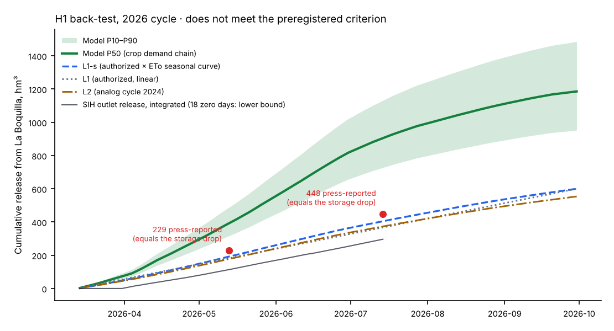

<!-- AI-assisted (Claude Code) — ROOT, NASA Space Apps 2026 -->
# Resultado de H1 · back-test del ciclo 2026 (DR-005, La Boquilla)

**H1: does not meet the preregistered criterion.** En el punto principal (14-jul-2026) el error del modelo es mayor
que el de L1-s y que el de L1. Se publica tal como salió.

**Fuente de verdad usada:** 447.65 hm³ de prensa, rotulada "press-reported; equals the storage drop". La serie
oficial del SIH trae 18 días con cero en el periodo (14 al 31 de marzo), así que aplica el respaldo que el preregistro
ya preveía. La salida integrada del SIH (296.31 hm³) se reporta al lado; es un piso (`docs/h1_verdad_sih.md`).

## Punto principal, 14-jul-2026 (hm³ acumulados desde el 14-mar)
| | Estimación | Error frente a prensa (447.65) | Error frente al SIH (296.31) |
|---|---|---|---|
| **Modelo, P50 (P10–P90)** | **904.6** (727.2–1131.4) | **456.9** | 608.2 |
| L1-s (autorizado × curva de ETo) | 404.5 | 43.2 | 108.1 |
| L1 (autorizado, lineal) | 367.2 | 80.5 | 70.9 |
| L2 (ciclo análogo 2024) | 373.3 | 74.3 | 77.0 |

- Skill del modelo (1 − error modelo ÷ error línea base), con la verdad de prensa: -9.58 frente a L1-s, -4.68 frente a L1 y -5.15 frente a L2. Un skill negativo significa que la línea base estuvo más cerca.
- La verdad queda **fuera** del intervalo P10–P90 del modelo.
- Punto de consistencia (13-may, no decide): modelo 391.9 (316.4–487.6); L1-s 191.8; L1 182.1; prensa 228.86; SIH 113.36. Mismo sentido.
- Con un solo ciclo no se habla de exactitud ni de significancia.

## Por qué falla: el nivel, no la forma
- El modelo calcula la demanda **completa** del cultivo: para todo el ciclo da 1185.7 hm³ en presa atribuibles a La Boquilla, casi el doble de los 600 hm³ autorizados. La lámina que resulta en presa ronda 2.8 m, frente a 1.514 m de mediana histórica en la serie de Conagua (27 años con entrega).
- Es decir: el distrito opera con mucha menos agua de la que la cadena FAO-56 ÷ eficiencia de parcela ÷ eficiencia de conducción supone necesaria. Apunta en la misma dirección que el contraste de ET (A8: la ETc modelada supera en 53 % a la ET de SSEBop) y que Villalobos-Cano et al. 2024 (ET ÷ agua aplicada = 65.6 % en alfalfa). No distingue entre riego por debajo de la demanda, eficiencias reales mayores que las supuestas, agua de pozo o reúso.
- **Variante «anclada» (sensibilidad declarada antes de correr; no decide):** si el total del modelo se iguala al total de L1 y solo se compara la forma dentro del ciclo, el modelo da 457.7 hm³ al 14-jul: queda a 10.1 hm³ de la cifra de prensa, más cerca que L1-s (43.2) y que L1 (80.5). Frente a la integral del SIH no mejora a las líneas base. En 2026 la forma quedó cerca de la cifra de prensa; el nivel no. Que la forma sirva en general se probó aparte y no se sostiene (punto siguiente).

- **La forma tampoco se sostiene en otros años (H1-b, prueba nueva del 14-nov, `docs/resultado_H1b.md`):** se probó si esa
  forma describe los ciclos 1999–2024. No: el modelo gana a las formas simples en 6 de 26 años y adelanta la demanda (da
  76 % del ciclo al 14-jul; lo observado es 68 %). La cercanía de 2026 fue de un año. La forma que mejor sigue a la presa
  es la más simple: la curva de ETo de NASA POWER (mediana de error de 3.3 puntos porcentuales).

## Sensibilidades (declaradas antes de correr; ninguna cambia el veredicto principal)
| Variante | Modelo P50 (P10–P90) | L1-s | L1 | Con prensa | Con SIH |
|---|---|---|---|---|---|
| Autorizado de 500 hm³ | 753.8 (606.0–942.8) | 337.0 | 306.0 | does not meet | does not meet |
| Fracción de L1 = 1.15 | 904.6 (727.2–1131.4) | 465.2 | 422.4 | does not meet | does not meet |
| Fin de ciclo el 31-oct | 904.6 (727.2–1131.4) | 368.7 | 318.1 | does not meet | does not meet |
| Patrón de cultivos 2024-25 | 969.9 (777.0–1217.8) | 404.5 | 367.2 | does not meet | does not meet |
| Patrón de cultivos 2016-17 | 894.4 (718.9–1118.8) | 404.5 | 367.2 | does not meet | does not meet |
| Modelo anclado al total de L1 (solo forma) | 457.7 (456.6–458.9) | 404.5 | 367.2 | meets | does not meet |

## Cómo se hizo
- Script `datos/colab/A6_backtest.py`; salidas `h1_resultado.json`, `h1_series.csv`. Monte Carlo de 10,000 corridas; climatología de NASA POWER 1991–2025.
- Superficie autorizada derivada: 42,937 ha (650 hm³ ÷ lámina bruta histórica mediana). Patrón de cultivos 2023-24 de Conagua: alfalfa 41%, nogal 27%, maíz forrajero 10%, chile 6%, algodón 0.7%, otros 16%.
- L2: el ciclo análogo es 2024 (almacenamiento al 14-mar de 1082.085 hm³, igual al de 2026 en la serie del SIH); salida de ese ciclo, 553.8 hm³.
- No aplicado: sorteo de Kc, fracción de lavado y calibración contra ciclos previos.

## Desviaciones y límites (sección 10 del preregistro)
1. **Puntos que el preregistro dejaba pendientes** (periodo de climatología, superficie autorizada, patrón de cultivos, fracción de L1, rangos de eficiencia): se fijaron en `docs/h1_especificacion_operativa.md`, subido al repositorio a las 14:11 del 14-nov, **antes** de correr el modelo. La sesión que hizo el análisis no tuvo a la vista la versión publicada del preregistro; si esta fija algo distinto, prevalece y el análisis se repite.
2. **Resultados conocidos de antemano:** las cifras de prensa y la serie del SIH ya se conocían al fijar la especificación.
3. La cifra de prensa equivale a la caída de almacenamiento (447.99 hm³ en la serie oficial): incluye evaporación y entradas, no es extracción medida. La integral del SIH omite 18 días. La extracción real debe estar entre ambas.
4. No se sabe si las cifras incluyen entregas fuera del DR-005. El cierre oficial del ciclo 2026 no está publicado: es un **partial back-test**.
5. A los cultivos sin Kc en el modelo (16% de la superficie: cacahuate, cebolla, melón, sandía y otros) se les asignó la lámina media de las anuales modeladas.

Rótulo para la página: "H1 does not meet the preregistered criterion (partial back-test; press-reported truth)".
