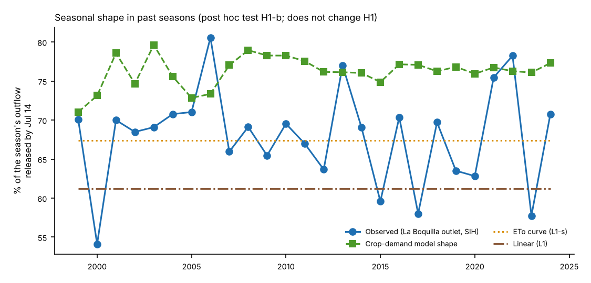

<!-- AI-assisted (Claude Code) — Raíz, NASA Space Apps 2026 -->
# Resultado de H1-b · forma estacional en ciclos anteriores (1999–2024)

**H1-b does not hold.** La forma estacional del modelo de demanda **no** describe la salida de La Boquilla mejor que las
formas simples. Se publica tal como salió. **No cambia H1**, que sigue en *does not meet the preregistered criterion*.

Prueba nueva (post hoc), definida en `docs/h1b_especificacion.md` y subida al repositorio (commit `695caf8`, 14-nov-2026,
16:20; el texto de la especificación dice 16:30, la hora del commit es la que vale) **antes** de calcular nada.
Script: `datos/colab/A6b_forma_historica.py`; datos: `h1b_anios.csv`, `h1b_resultado.json`.

## Resultado
| | Modelo de demanda | L1-s (curva de ETo de NASA POWER) | L1 (lineal) |
|---|---|---|---|
| Fracción del ciclo que da al 14-jul | 71–80 % según el patrón de cultivos | 67.4 % | 61.2 % |
| Mediana del error (puntos porcentuales, 26 años) | **8.66** | **3.34** | 7.9 |

- Condición 1 (el modelo gana a las dos formas simples en más de la mitad de los años): **no**. Gana en 6 de 26.
- Condición 2 (mediana del error del modelo menor que las otras dos): **no**.
- Prueba de signos, solo descriptiva: 0.9988.

## Qué dice
- En promedio, al 14 de julio ya salió el 68.0 % del agua del ciclo. El modelo de demanda dice 76.2 %: **adelanta** la
  demanda (pide más agua en primavera de la que la presa entrega). La curva de ETo da 67.4 %.
- La cercanía de la variante «anclada» en 2026 (457.7 frente a 447.65 hm³) **no se repite** en los años anteriores: fue
  un año, no una regla. Queda dicho así en `docs/resultado_H1.md`.
- Lo que sí se sostiene en los datos, como **descripción** y no como hipótesis registrada: la forma más simple —volumen
  del ciclo repartido con la curva climatológica de ETo de NASA POWER— es la que mejor sigue la salida de la presa:
  mediana de error de 3.34 puntos, mejor que la lineal en 19 de 26 años y la mejor de las tres en 13 (su error llega a 13.3 puntos en el peor año).
- Observación sin prueba (vista después de correr): los 6 años en que gana el modelo están entre los 10 ciclos con menos
  agua (menos de 530 hm³ de salida) y no gana en ninguno de los otros 16; en los ciclos con poca agua la presa entrega
  antes (73.1 % al 14-jul frente a 64.8 % en los demás). Es una pista para otra prueba, no un resultado.

## Sensibilidades (declaradas antes de correr; no deciden)
| Variante | Años en que gana el modelo | Mediana modelo | Mediana L1-s | Mediana L1 | H1-b |
|---|---|---|---|---|---|
| Patrón de cultivos del mismo año | 6 de 26 | 7.57 | 3.34 | 7.9 | does not hold |
| Corte al 13 de mayo | 9 de 26 | 3.46 | 3.27 | 2.85 | does not hold |
| Fin de ciclo el 31 de octubre | 13 de 26 | 6.71 | 7.11 | 15.19 | does not hold |
| Sin años con 10 o más días de salida cero (abr–ago) | 5 de 25 | 8.74 | 3.34 | 7.89 | does not hold |

## Por año
| Año | Salida del ciclo (hm³) | Observado al 14-jul | Modelo | Error modelo (pp) | Error L1-s (pp) | Error L1 (pp) | ¿Gana el modelo? |
|---|---|---|---|---|---|---|---|
| 1999 | 361 | 70.1 % | 71.0 % | 0.97 | 2.65 | 8.86 | sí |
| 2000 | 699 | 54.1 % | 73.1 % | 19.01 | 13.29 | 7.07 | no |
| 2001 | 439 | 70.0 % | 78.6 % | 8.58 | 2.58 | 8.8 | no |
| 2002 | 413 | 68.5 % | 74.7 % | 6.18 | 1.07 | 7.29 | no |
| 2003 | 410 | 69.1 % | 79.6 % | 10.54 | 1.68 | 7.89 | no |
| 2004 | 306 | 70.8 % | 75.6 % | 4.83 | 3.35 | 9.57 | no |
| 2005 | 431 | 71.0 % | 72.8 % | 1.82 | 3.62 | 9.83 | sí |
| 2006 | 523 | 80.6 % | 73.4 % | 7.22 | 13.16 | 19.37 | sí |
| 2007 | 676 | 66.0 % | 77.0 % | 11.07 | 1.46 | 4.76 | no |
| 2008 | 698 | 69.1 % | 79.0 % | 9.84 | 1.71 | 7.92 | no |
| 2009 | 771 | 65.5 % | 78.3 % | 12.81 | 1.95 | 4.27 | no |
| 2010 | 783 | 69.5 % | 78.3 % | 8.74 | 2.12 | 8.33 | no |
| 2011 | 845 | 67.0 % | 77.5 % | 10.59 | 0.44 | 5.77 | no |
| 2012 | 875 | 63.7 % | 76.2 % | 12.49 | 3.73 | 2.48 | no |
| 2013 | 468 | 77.0 % | 76.1 % | 0.86 | 9.58 | 15.79 | sí |
| 2014 | 559 | 69.1 % | 76.0 % | 6.98 | 1.65 | 7.86 | no |
| 2015 | 760 | 59.6 % | 74.9 % | 15.29 | 7.83 | 1.62 | no |
| 2016 | 758 | 70.4 % | 77.1 % | 6.77 | 2.96 | 9.18 | no |
| 2017 | 986 | 58.0 % | 77.1 % | 19.07 | 9.4 | 3.18 | no |
| 2018 | 738 | 69.7 % | 76.2 % | 6.54 | 2.3 | 8.51 | no |
| 2019 | 854 | 63.5 % | 76.8 % | 13.32 | 3.9 | 2.31 | no |
| 2020 | 871 | 62.8 % | 75.9 % | 13.1 | 4.58 | 1.63 | no |
| 2021 | 356 | 75.5 % | 76.7 % | 1.29 | 8.05 | 14.26 | sí |
| 2022 | 446 | 78.2 % | 76.3 % | 1.97 | 10.83 | 17.04 | sí |
| 2023 | 767 | 57.8 % | 76.1 % | 18.34 | 9.66 | 3.44 | no |
| 2024 | 554 | 70.8 % | 77.3 % | 6.55 | 3.34 | 9.55 | no |

## Límites
- Los años no son independientes (misma climatología; el patrón de cultivos cambia despacio). No se habla de significancia.
- La climatología 1991–2025 incluye los años evaluados; afecta igual al modelo y a L1-s.
- La salida de la presa responde también a decisiones de operación (calendario de riegos, mantenimiento), no solo a la demanda.
- La serie del SIH puede traer ceros que sean huecos (2022 tiene 12 días con cero de abril a agosto).
