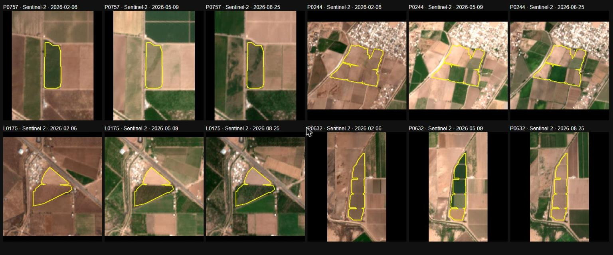

<!-- AI-assisted (Claude Code) — ROOT, NASA Space Apps 2026 -->
# Revisión de las parcelas protagonistas en color verdadero (kit B1, paso 4)

**Fecha de la revisión:** 14-nov-2026, 15:50 (hora de Chihuahua).
**Quién revisó:** la sesión de datos (asistente de IA), mirando las imágenes. **No sustituye la revisión de una persona
del equipo que conozca la zona**, que sigue pendiente; el kit la marca como revisión manual obligatoria.
**Imágenes:** Sentinel-2 L2A en color verdadero (bandas B4, B3, B2), colección `COPERNICUS/S2_SR_HARMONIZED` en Google Earth
Engine (proyecto iondroplet), tesela T13RDM, la escena con menos nubes de cada periodo:

| Fecha | Escena | Nubes en la escena |
|---|---|---|
| 6-feb-2026 | `20260206T174419_20260206T174757_T13RDM` | 0 % |
| 9-may-2026 | `20260509T172901_20260509T174413_T13RDM` | 0.1 % |
| 25-ago-2026 | `20260825T173859_20260825T175354_T13RDM` | 0 % |

Figura: `docs/figuras/protagonistas_sentinel2_2026.jpg` (contorno de la parcela en amarillo; contiene datos Copernicus
Sentinel modificados, 2026). Se contrasta con el NDVI mensual de HLS de `hls_mensual_parcelas.csv` y con la altura de GEDI
de `gedi_parcelas.csv`.

*Contains modified Copernicus Sentinel data 2026.*

| Parcela | Lo que dice el sistema | Qué se ve | ¿Coincide? |
|---|---|---|---|
| **P0757** (7.95 ha, junto a Km 92) | Alfalfa de 3 años, «por vencer» | Una sola parcela rectangular, bien delimitada. Verde oscuro en febrero, verde pálido en mayo (aspecto de recién cortada) y verde irregular en agosto. NDVI entre 0.49 y 0.84 los 12 meses. GEDI: 11 disparos, mediana 2.9 m (sin árboles) | **Sí.** Cultivo verde todo el año, sin dosel alto: compatible con alfalfa. El contorno coincide con la parcela |
| **P0244** (27.97 ha, junto a El Molino) | En descanso en 2026, «libre» | El polígono **junta unas 7 parcelas chicas** pegadas al poblado. En febrero todas están sin cultivo; en mayo y agosto 2 o 3 de ellas (alrededor de la cuarta parte de la superficie) están verdes y el resto sigue sin cultivo. NDVI mediano de 0.19 a 0.31, con el cuartil alto hasta 0.62 de mayo a septiembre | **En parte.** La mayor parte del polígono sí estuvo en descanso, pero no es una sola parcela ni estuvo toda sin cultivo. El contorno de Fields of The World no separa las parcelas |
| **L0175** (10.76 ha, Lázaro Cárdenas) | Huerta de nogal, «comprometida» | Dos partes: abajo (cerca de dos tercios) una huerta con textura de árboles, sin hojas en febrero y verde oscuro en mayo y agosto; arriba, un triángulo de suelo sin cultivo todo el año. GEDI: 3 disparos, mediana 13.6 m | **Sí en la huerta.** El contorno incluye además un lote sin cultivo: la superficie real de nogal es menor que las 10.76 ha del polígono |

## Parcela «libre» que sí muestra agua (pedido del integrador)
P0244 es «libre», pero su opción actual es descanso: lámina 0 y La gota sin flujo. Candidatas con cultivo anual en 2026
(clase `cereal_invierno`, estado «libre»), con confianza de Fields of The World y tamaño parecidos (P0244: 56 y 28 ha):

| Parcela | Superficie | Confianza FTW | Distancia | Qué se ve | Recomendación |
|---|---|---|---|---|---|
| **P0632** | 20.66 ha | 54 | 3.2 km de Km 92 | Franja de 5 tablas contiguas con el mismo manejo: brota en febrero (NDVI 0.46), verde pleno en marzo y abril (0.86–0.90, cuartiles 0.81–0.90: homogénea), cosechada en mayo y sin cultivo en verano. Memoria: cultivo de verano de 2019 a 2025 y de invierno en 2026. GEDI: 20 disparos, sin dosel alto | **Primera opción.** Es la más homogénea |
| P0605 | 31.91 ha | 55 | 3.0 km de Km 92 | Junta dos manejos: dos tercios con cereal de fines de invierno (verde de marzo a mayo) y un tercio con cultivo de verano (verde en agosto) | Segunda opción: polígono mixto |
| P0742, P0683 | 169 y 178 ha | 56 y 55 | 1.6 y 1.9 km de Km 92 | Polígonos de Fields of The World que juntan muchas parcelas | No: no son una parcela |

Observación sobre la clase: lo que las reglas llaman `cereal_invierno` en estas parcelas es un cultivo de fines de invierno
y primavera (verde de febrero a abril o mayo). El nombre del cultivo no se puede confirmar con la imagen.

**Actualización, 14-nov 16:28:** por decisión del integrador (`docs/decisiones/2026-11-14_opciones_b3.md` en su rama), la protagonista «libre» pasa a ser **P0632** y P0244 deja de serlo (sigue en el mapa como cualquier parcela). `parcelas_base.geojson` se regeneró con las marcas P0757, P0632 y L0175. La revisión de P0632 es la de la tabla de arriba y vale lo mismo que las otras: hecha por la sesión de datos sobre Sentinel-2; falta la de una persona.

## Lo que falta
- Que una persona del equipo que conozca Km 92, El Molino y Lázaro Cárdenas confirme el cultivo de estas parcelas.
- Si se quiere corregir el contorno de P0244 y L0175, hay que dibujarlo a mano (el kit lo prevé); no se hizo.
